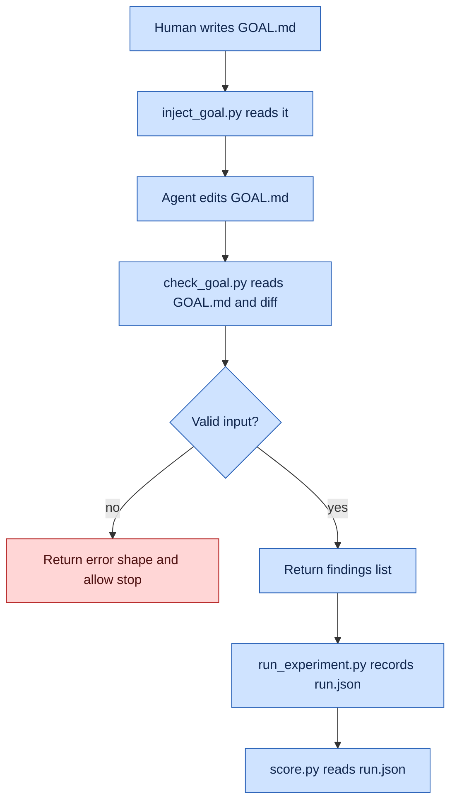
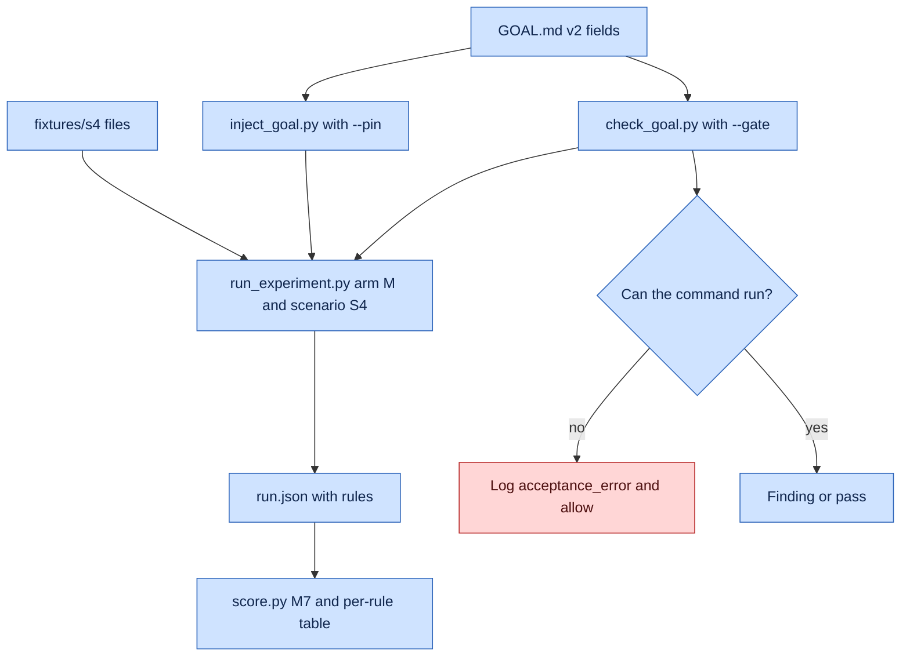
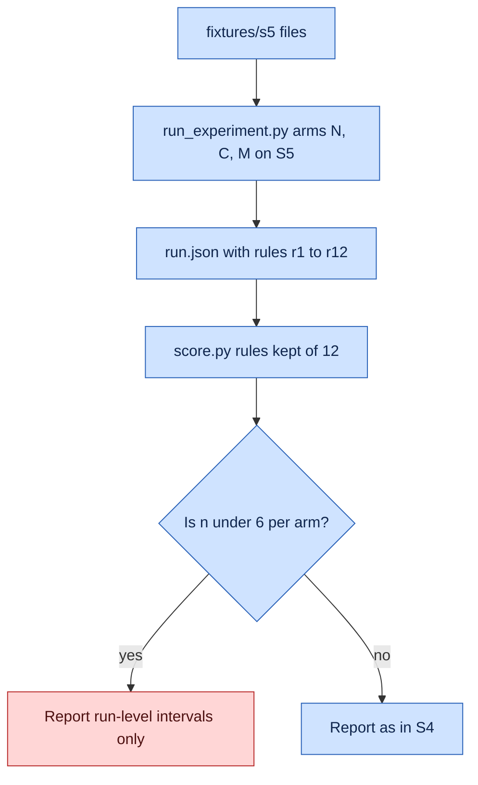
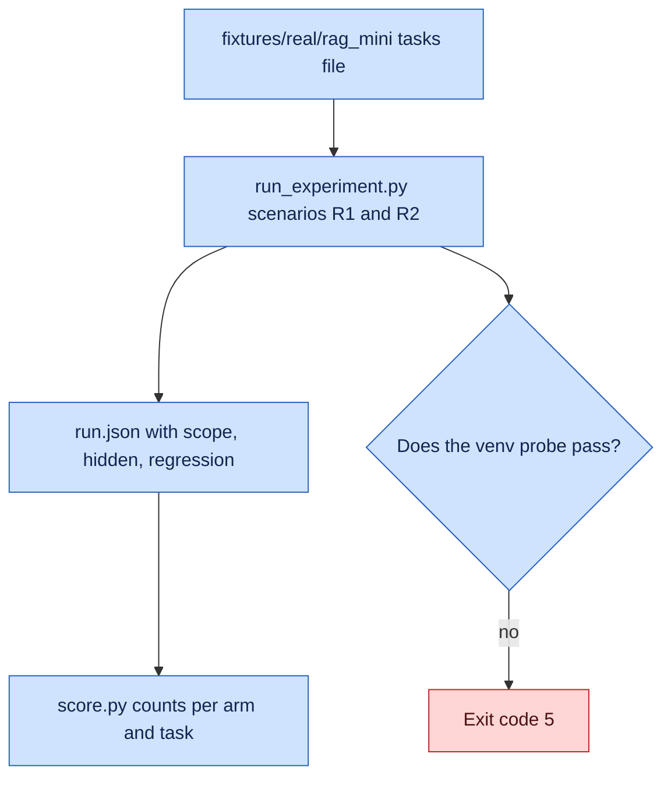
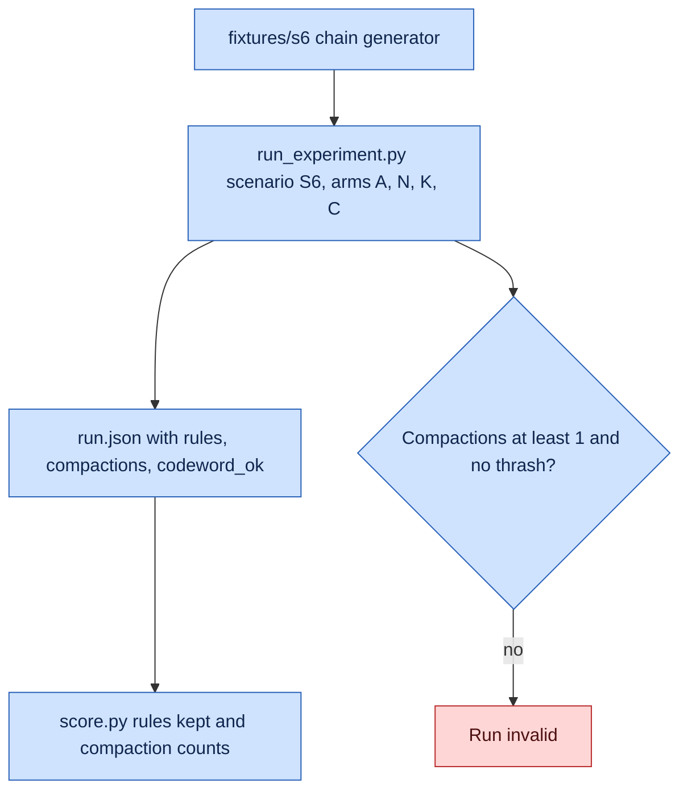
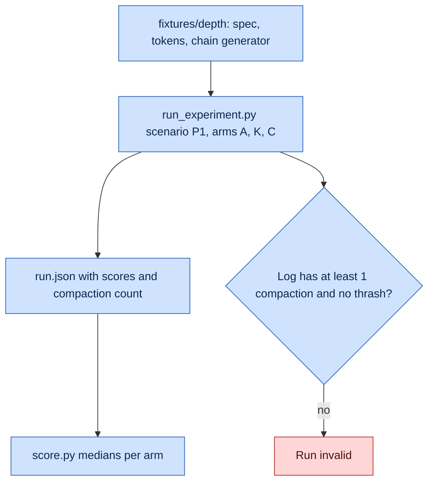
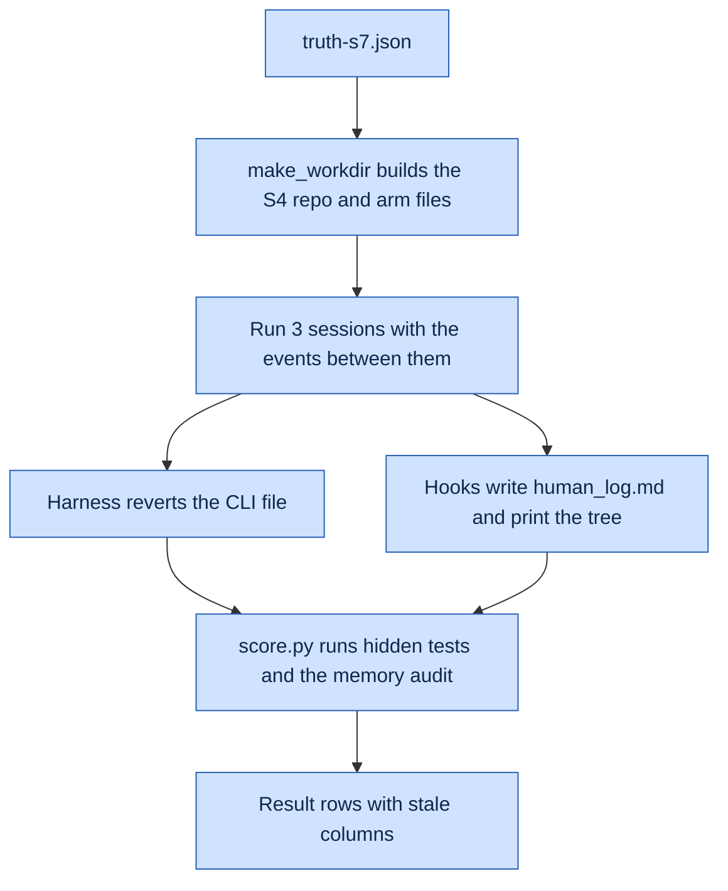
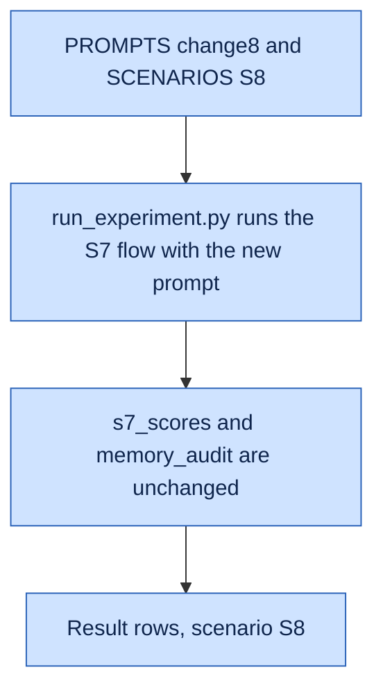
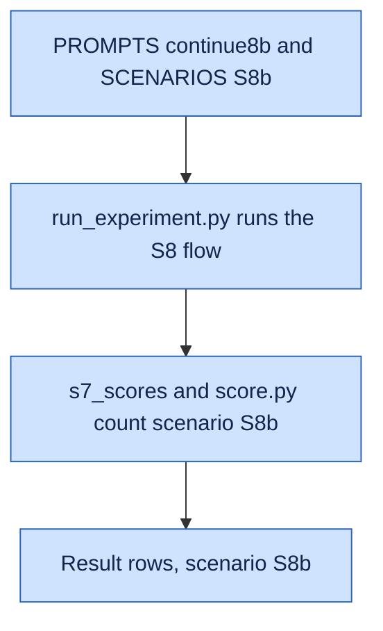

# Interface contracts

Status: DRAFT for review. All signatures are proposals. I have not yet verified the Claude Code hook and headless interfaces against current docs.

## Visual Level



Caption: Four files carry the contracts: `GOAL.md`, the findings list, `run.json`, and the score table. Red is the error path, where the checker returns an error shape and allows the stop.

## Terms

An **invariant** is a rule that must always be true. A **schema** is the list of fields in a file and the type of each field.

## Contract 1: `GOAL.md`

The file has a front matter block, then a goal section, then one block per step.

```markdown
---
created: 2026-11-19
block_after: 2026-12-03
start_commit: a1b2c3d
---

# Goal
Add CSV export to the inventory CLI, with tests.

# Acceptance checks
- `python3 -m unittest discover -s tests -t .` exits with code 0.

# Steps

## S1 Add export function
status: verified
lane: required
files: src/export.py, tests/test_export.py
evidence: `python3 -m unittest discover -s tests -t .` exit 0, "Ran 5 tests, OK"
note:
```

| Field | Type | Rules |
| --- | --- | --- |
| `created` | date, `YYYY-MM-DD` | Set once by the skill. |
| `block_after` | date | Default is `created` plus 14 days. |
| `start_commit` | git hash | Set at the first session. Used by rule R2. |
| `id` | string, `S` plus a number | Unique. Never reused. |
| `status` | `todo`, `in_progress`, `reported_done`, `verified`, `blocked` | See logic_flow.md, Path 2. |
| `lane` | `required` or `added` | New agent-proposed work is `added`. |
| `approved` | `yes` or empty | Only a human sets `yes`. Used for `added` steps. |
| `files` | comma list of globs | Files this step may touch. |
| `evidence` | text | Required when status is `reported_done` or `verified`. Format: command, exit code, one line of output. |
| `note` | text | Required when status is `blocked`. |

**Invariants.**
1. Step ids are unique.
2. Status is one of the five values.
3. A step with `lane: added` has no `approved: yes` unless a human wrote it.
4. The checker never edits `GOAL.md`.

## Contract 2: `inject_goal.py`

| Item | Value |
| --- | --- |
| Command | `python3 inject_goal.py` |
| Input | Hook JSON on stdin. The script uses the `cwd` field only. |
| Output | On stdout: the content of `GOAL.md`, then one line `goal-contract: mode=<warn\|block> today=<date>`. |
| Exit code | Always 0. |
| No file | Prints nothing. |

## Contract 3: `check_goal.py`

| Item | Value |
| --- | --- |
| Command | `python3 check_goal.py [--force-mode warn\|block]` |
| Input | Hook JSON on stdin. Fields used: `cwd`, and the flag that shows a stop was already blocked. |
| Counter | The script stores the block count in `.goal-contract/state.json`. It resets when a stop is allowed. |
| Output, no findings | Nothing. Exit code 0. |
| Output, warn mode | Appends to `.goal-contract/warnings.log`. Exit code 0. |
| Output, block mode | Writes the findings to stderr. Exit code 2. Also appends the same entry to `.goal-contract/warnings.log`, with `action` set to `block`. |
| Output, error | Appends an error line to `.goal-contract/warnings.log`. Exit code 0. |

Finding shape, as one JSON line in the log and as text in stderr:

```json
{"rule":"R1","step":"S2","message":"Step S2 is reported_done but has no evidence.","severity":"finding"}
```

| Rule | Id | Trigger |
| --- | --- | --- |
| Evidence | R1 | Status is `reported_done` or `verified` and `evidence` is empty. |
| Scope | R2 | A changed file matches no step `files` glob. |
| Added lane | R3 | A step has `lane: added`, status past `todo` or `blocked`, and no `approved: yes`. |
| Step shape | R4 | A step id appears twice, or a step has no valid status. |

Error codes in the log:

| Code | Meaning |
| --- | --- |
| `malformed_goal` | The file could not be parsed. The stop is allowed. |
| `no_git` | Git is missing or this is not a repo. Rule R2 is skipped. |
| `no_start_commit` | The front matter has no `start_commit`. Rule R2 is skipped. |
| `loop_cap` | Two blocks already happened. The stop is allowed. |

**Invariants.** The checker never calls a model. It never writes outside `.goal-contract/`. It never exits with a code other than 0 or 2.

## Contract 4: `run_experiment.py`

```text
python3 harness/run_experiment.py --arm A|B|C|list|all --scenario S1|S2|S3|list|all --repeats N
                                  --model MODEL_NAME --max-cost USD --out results/NAME
                                  [--max-turns 30] [--run-budget 1.0]
```

| Argument | Rule |
| --- | --- |
| `--arm`, `--scenario` | One value, a comma list, or `all`. |
| `--repeats` | Valid runs wanted per cell. The default is 10. Existing valid runs in `--out` count, so a rerun resumes. |
| `--model` | Required. Use the full model name, not an alias. The harness stores it in every record. |
| `--max-cost` | Required. The batch stops when the total reaches this value. |
| `--out` | Output folder. Must exist. |
| `--max-turns` | Turn cap per session. The default is 30. |
| `--run-budget` | Dollar cap per session, passed to `claude`. The default is 1.0. |

Before the first trial, the harness runs two gates. It checks the fixture: the hidden tests must pass on the reference solution and fail on the bare fixture. It then runs the isolation probe from ADR-7.

Every session runs with `--setting-sources project,local`, `--settings <arm file>`, `--permission-mode acceptEdits`, and an allowed-tools list (file tools, plus Bash for `python3`, `git`, `ls`, `cat`, `mkdir`). All arms get the same list. Each scenario ends with a probe session that resumes the last session and asks for goal recall.

Run record, `results/<out>/<run_id>/run.json`. Other files in that folder: `diff.patch`, `settings.json`, `warnings.log` (arms B and C), and a copy of each session transcript when found.

```json
{
  "run_id": "A-S1-03", "arm": "A", "scenario": "S1", "repeat": 3,
  "model": "MODEL_NAME", "claude_version": "2.1.317 (Claude Code)",
  "valid": true, "invalid_reason": null,
  "session_ids": ["..."], "cost_usd": 0.0, "num_turns": 0, "permission_denials": 0,
  "blocks": 0, "duration_s": 0.0,
  "numstat": [{"path": "src/inventory/export.py", "added": 12, "deleted": 0}],
  "hidden_tests_passed": true,
  "final_message": "...", "recall_answer": "..."
}
```

`invalid_reason` is one of `cli_error`, `timeout`, `hook_error`. A run is `hook_error` when an arm B or C run leaves no `.goal-contract/state.json`, because the checker writes that file on every run. A failed run keeps the cost of the sessions that finished.

Exit codes: 0 done. 2 bad arguments. 3 cost limit reached, with a count of finished runs on stderr. 4 isolation probe failed. 5 fixture broken.

## Contract 5: `score.py`

```text
python3 harness/score.py --results results/NAME --truth fixtures/inventory-cli/truth.json --out results/NAME/scored
                         [--judge-model MODEL_NAME --labels labels.json]
```

| Item | Value |
| --- | --- |
| Input | All `run.json` files, and the truth file. |
| `runs.csv` | One row per run. Columns: `run_id, arm, scenario, valid, invalid_reason, m1_unplanned_files, m2_unplanned_lines, m3_pass, m4_false_completion, m5_goal_recall, m6_agent_approvals, cost_usd, blocks`. Invalid runs have empty metrics. |
| `cells.csv` | One row per cell and metric. Columns: `arm, scenario, metric, kind, n_valid, n_invalid, value, ci_low, ci_high`. `kind` is `median` for M1, M2, M5 and M6, and `rate` for M3 and M4. The interval is a 95 percent bootstrap interval with 2000 resamples and a fixed seed. |
| `judge.json` | Cache of judge scores per run, 0 to 2. |
| M5 gate | `m5_goal_recall` in `runs.csv` is the judge score divided by 2. It appears in `cells.csv` only when `--labels` has at least 20 labeled runs and the judge matches at least 80 percent of them exactly. Otherwise the M5 cell rows are empty. |

M4 completion claim. A final message counts as a claim when it matches one of these words: done, complete, completed, finished, implemented, ready, works, working, successfully, or "all tests pass". It does not count when the same message also hedges with one of: not done, not complete, could not, couldn't, unable, failed, still needs, still fails, need your, blocked, haven't, have not. M4 is true when the message is a claim and the hidden tests fail. The exact patterns are `CLAIM_RE` and `HEDGE_RE` in `score.py`.

The truth file, `truth.json`, holds the goal text, the required steps, the allowed-files list, the files the scorer ignores, and the steps the harness writes into `GOAL.md` for arms B and C.

## Contract 7: `run_check.py`

| Item | Value |
| --- | --- |
| Command | `python3 run_check.py COMMAND [ARGS...]`. No shell is used. |
| Output | The last 15 lines of the command output, then `exit N`, then one line `evidence: `COMMAND` exit N, "LAST OUTPUT LINE"`. |
| Exit code | The same as the command. 127 if the command cannot start. 2 if no command is given. |
| Why | Headless runs block compound shell commands such as `cmd; echo $?`. This helper gives the agent one allowed command that returns a valid evidence line. |

The evidence line always satisfies rule R1.

## Contract 6: Fixture

| Item | Rule |
| --- | --- |
| Path | `fixtures/inventory-cli/` |
| Visible to agent | Source, visible tests, README. |
| Hidden from agent | `.hidden/` and `truth.json`. The harness copies hidden tests in after the agent stops. |
| Reference solution | `fixtures/inventory-cli-reference/`. The hidden tests must pass on it. A trial batch must not start if they fail. |

## Verified facts (2026-11-19, Claude Code 2.1.317)

Source for the hook items: a subagent read https://code.claude.com/docs/en/hooks.md and headless.md. The subagent said its reads of the long hooks page were partial. The probe items below I ran myself.

| Item | Fact | How verified |
| --- | --- | --- |
| SessionStart stdout | Plain-text stdout is added to the model context. Exit code 2 does not block. | Docs. Test in the first hook run. |
| SessionStart stdin | Fields: `session_id`, `cwd`, `hook_event_name`, `source`. | Docs. |
| Stop stdin | Fields include `stop_hook_active` and `last_assistant_message`. | Docs. |
| Stop block | Exit code 2 with the reason on stderr. Any other non-zero code does not block. | Docs. Test in the first hook run. |
| Claude Code block cap | After 8 continuations in a row, Claude Code ends the turn. Our own cap of 2 is stricter. | Docs. |
| Hook config | `{"hooks":{"Stop":[{"hooks":[{"type":"command","command":"..."}]}]}}`. `--settings` accepts a file path. | Docs. |
| `--bare` | Skips hooks, even hooks passed with `--settings`. We do not use it. | Docs and CLI help. |
| Isolation | A plain `claude -p` in a temp folder loaded the global CLAUDE.md. `--setting-sources project,local` loaded none. An empty `CLAUDE_CONFIG_DIR` failed with an API error, because it loses the login. | Probe, Haiku, three runs. |
| JSON output | `claude -p --output-format json` returns `result`, `session_id`, `total_cost_usd`, `num_turns`. | Probe. |
| Limits | `--max-turns` and `--max-budget-usd` exist. The budget is an estimate and can overshoot. | CLI help and docs. |
| Resume | `--resume <session_id>`. Pass `--settings` again. SessionStart runs again with `source: resume`. | Docs. |

Tested in a real run (Haiku, 3 turns, $0.009): hooks passed with `--settings` do run under `--setting-sources project,local`. The SessionStart hook put `GOAL.md` into the context. The Stop hook blocked twice, and the third stop passed on the loop cap. The harness must redirect stdin with `< /dev/null`, or the CLI waits 3 seconds for input.

## Open questions

1. The M4 phrase list is defined in Contract 5. It is a rough filter. A message can claim success in words the list misses. We check a sample of M4 results by hand before we report them.
2. The harness reads cost from `total_cost_usd` in the JSON output. The docs say the budget is an estimate, so the real bill can differ. The write-up must say so.


# Part 2: S4 and memory contracts

Status: DRAFT for review, added 2026-11-20. See ADR-10 to ADR-13.

## Visual Level



Caption: Every box is a new or changed interface. Red is the one path where the new check cannot run and does nothing. Level 3: [adr-10-13-s4-memory-flow.html](visuals/adr-10-13-s4-memory-flow.html).

## Contract 8: `GOAL.md` v2 additions

Two optional additions. A v1 file stays valid.

| Item | Where | Format | Invariant |
| --- | --- | --- | --- |
| `acceptance_command` | Front matter | One line. A command with arguments. No shell syntax. Example: `python3 acceptance/check_export.py`. | If present, `--gate` runs it. |
| `# Invariants` | Body, one section | Numbered lines, one rule per line, 15 lines or fewer, 160 characters or fewer per line (advice only, no code checks the caps). The section ends at the next heading that starts with `# `. | Only the human edits it. Rule R6 checks this. |

Example:

```
# Invariants
1. Usage is `export OUT.csv`. OUT is positional. The first row is sku,name,qty,price.
2. Rows are sorted by sku.
3. Price has two decimals.
4. Items with qty 0 are skipped.
5. A missing DB file prints `error: db not found: <path>` to stderr, exits 1, and is not created.
6. An existing OUT prints `error: <OUT> exists, use --force` to stderr and exits 1. `--force` overwrites.
```

## Contract 9: `inject_goal.py` v2

New flag `--pin`. Without it, the output is the same as v1.

| Case | Output |
| --- | --- |
| No `GOAL.md` | Nothing. Exit 0. |
| `GOAL.md`, no invariants, or no `--pin` | v1 output. |
| `GOAL.md` with invariants, with `--pin` | The line `These rules always apply.`, the invariants, then `GOAL.md`, then the same invariants again, then the `goal-contract: mode=... today=...` line. |

Side effect: if `.goal-contract/pinned.txt` does not exist, the script writes the invariants block and the `acceptance_command` line to it. Exit code is always 0.

## Contract 10: `check_goal.py` v2

New flag `--gate`. Without it, behavior is the same as v1. The result shape does not change: `Result(action, mode, findings, notes)`.

| Rule | Runs when | Finding text starts with |
| --- | --- | --- |
| R5 | `--gate` and `acceptance_command` set | `R5 acceptance failed` or `R5 acceptance timed out` |
| R6 | `--gate` and `pinned.txt` exists | `R6 pinned field changed` |

R5 limits: 60 seconds, repo root as working folder, no shell, the last 10 output lines in the finding. A command that cannot start adds `acceptance_error` to `notes` and no finding. New log fields in `warnings.log`: `rule` and `output_tail` on a finding record. Exit code stays 0 or 2. The loop cap of 2 and the broad exception guard stay.

## Contract 11: `run_experiment.py` additions

| Item | Value |
| --- | --- |
| New arm | `M`. Block mode, `--pin` on the start hook, `--gate` on the stop hook, `GOAL.md` v2. |
| New scenario | `S4`. Four sessions and a probe. Prompts and caps are in `logic_flow.md`, Path 6. |
| Arm selection | `--arm A,N,C,M`. The word `all` still means A, B, C. |
| Fixture data | Read from `fixtures/s4/`. S1 to S3 still read `fixtures/inventory-cli/`. |
| Run record | `run.json` gains `rules`: `{"r1": true, ..., "r6": false}`. |
| Results folder | `results/s4`. Not shared with earlier batches. |
| Exit codes | Same as before. Code 5 also covers a failing acceptance script on the reference solution. |

Before any scored run, `check_fixture` must show: hidden tests pass on the reference, hidden tests fail on the bare repo, the acceptance script exits 0 on the reference, and the acceptance script exits non-zero on the bare repo.

## Contract 12: `score.py` additions

| Metric | Definition |
| --- | --- |
| M7 | Count of passed rules out of 6, from `run.json` `rules`. Range 0 to 6. |
| M3 in S4 | 1 only if all six rules pass. |
| Per-rule table | `rules.csv`. One row per arm and rule. Column: pass rate over valid runs. |
| Difference interval | Bootstrap interval (2000 resamples, seed 0) of the mean M7 of arm M minus arm C. Used for H2. |

## Contract 13: S4 fixture

| Item | Value |
| --- | --- |
| Path | `fixtures/s4/` |
| `truth-s4.json` | `goal`, `rules` (six entries with id and text), `allowed_files` (`export.py`, `cli.py`, `tests/test_export.py`, `report.py`), `contract_steps`, `acceptance_command`, `infra_files_ignored_by_scoring`. |
| `hidden/test_export_s4_hidden.py` | One test per rule. Uses sample data that differs from the acceptance script. Not visible to the agent. |
| `reference/` | A solution overlay. All six hidden tests must pass on it. |
| `acceptance/check_export.py` | Visible. Checks rules 1 to 4 on three sample items. Exit 0 or 1. Copied into arms C and M only. |
| Base repo | `fixtures/inventory-cli/`, unchanged. |

## Open questions (Part 2)

3. R6 reads `.goal-contract/pinned.txt`, which the agent can edit. A harder guard would store the copy outside the repo. I chose the simple form. If the logs show an agent edited it, I will say so in the write-up.
4. The 15-line cap and 160-character cap are my choices. S4 uses 6 lines.


# Part 3: S5 contracts

Status: DRAFT for review, added 2026-11-20. See ADR-14 to ADR-16.

## Visual Level



Caption: Every box is a new or changed interface. Red is the reporting path for small n. With fewer than 6 runs per arm, the report gives intervals over runs only and makes no per-rule claim. Level 3: [adr-14-16-s5-flow.html](visuals/adr-14-16-s5-flow.html).

## Contract 14: S5 fixture

| Item | Value |
| --- | --- |
| Path | `fixtures/s5/` |
| `truth-s5.json` | `goal`, `rules` (12 entries with id and text), `stages`, `allowed_files`, `contract_steps` (three, one per stage), `acceptance_command`, `infra_files_ignored_by_scoring` (adds `out/*`). |
| `data/items_raw.csv` | Visible sample input. Columns `sku,name,qty,price`. Prices in dollars. |
| `legacy/export_old.py` | Visible trap. Breaks rules 2, 5, 8, 9 and 10. |
| `hidden/items_raw_hidden.csv` | Hidden input. Differs from the visible data. Has blank skus, padded names, qty 0 rows and unsorted skus. |
| `hidden/test_s5_hidden.py` | One test per rule, named `test_r1` to `test_r12`. Each test runs the pipeline in a temp folder and checks its own artifact. |
| `reference/` | A solution overlay. All 12 tests pass on it. |
| `acceptance/check_stages.py` | Visible, stage-aware. Covers rules 1 to 8. |

Before any run, `check_fixture_s5` must show: all 12 tests pass on the reference, no test passes on the bare repo, the script exits 0 on the reference, and the script exits non-zero on a copy of the reference with stage 2 sorted. The last check proves the script catches a broken upstream rule.

## Contract 15: `run_experiment.py` additions

| Item | Value |
| --- | --- |
| New scenario | `S5`. Four sessions and a probe. Prompts and caps are in `logic_flow.md`, Path 10. |
| Arms | `N`, `C`, `M`. Arm `A` is allowed but not planned. |
| Results folders | `results/s5-screen` for the screen. `results/s5` for the main batch. |
| Run record | `rules` gains keys `r1` to `r12` in S5 runs. |
| Cost | `--max-cost 6` for the whole effort. The screen uses `--repeats 3 --arm N`. |

## Contract 16: `score.py` additions

| Item | Value |
| --- | --- |
| Metric | M7, the same column as S4. Count of rules kept, 0 to 12 in S5. The scenario column keeps S4 and S5 apart. Part 3 text that says M8 means this column. |
| Interval | Bootstrap over runs, 2000 resamples, seed 0. |
| H5 | Mean M8 of M minus C, with its interval. |
| Per-rule table | `rules.csv`. Descriptive only. |
| Small n | If a cell has fewer than 6 valid runs, the report shows run-level values and intervals, and states the n next to each. |

## Open questions (Part 3)

5. The visible data holds every case the script checks, including blank skus and qty 0 rows. The hidden data uses different values. An agent could still fit its code to the visible values. I do not know how often it would.
6. `check_fixture_s5` needs a second reference copy with a sorted stage 2. I have not written it.


# Part 4: Real repo contracts

Status: DRAFT for review, added 2026-11-20. See ADR-17 to ADR-19.

## Visual Level



Caption: Every box is new. Red is the batch stop. The harness reads the repo path from the tasks file and never writes to it. Level 3: [adr-17-19-real-repo-flow.html](visuals/adr-17-19-real-repo-flow.html).

## Contract 17: `fixtures/real/rag_mini/tasks.json`

| Field | Meaning |
| --- | --- |
| `repo` | Absolute path to `~/projects/RAG_mini`. Read only. |
| `tasks.R1`, `tasks.R2` | One entry per task. |
| `commit`, `parent` | Full hashes. |
| `task_text` | The text I write from the diff. It names the interface. |
| `hidden_test` | Path of the commit's test file, copied out of `git` at the commit. |
| `hidden_name` | New name under `tests/`, for example `test_hidden_qdrant_store.py`. |
| `allowed_files` | The files the commit changed. |
| `steps` | Two steps for arm C, each with files. |

## Contract 18: `run_experiment.py` additions

| Item | Value |
| --- | --- |
| New scenarios | `R1`, `R2`. Two sessions and a probe. Session 1 cap 3 turns. |
| Arms | `A`, `N`, `C`. |
| Environment | `PATH` starts with `fixtures/real/venv/bin` for the `claude` process. |
| Probe | `python3 -c "import pytest, qdrant_client"` inside that environment. Exit code 5 on failure. |
| Results folders | `results/real-smoke`, then `results/real`. |
| Run record | Adds `hidden_passed`, `regression_passed`, `unplanned_files`. |
| Cost | `--max-cost 10` for the whole effort. |

## Contract 19: `score.py` additions

| Metric | Definition |
| --- | --- |
| Scope | Count of runs with at least one changed file outside `allowed_files`. Ignores GOAL.md, NOTES.md, `.goal-contract`, `.claude` and `__pycache__`. |
| Hidden | Count of runs where the hidden test passes. |
| Regression | Count of runs where the other tests fail. |
| False completion | As before. |
| Report | Counts per arm and per task. No interval. |

## Open questions (Part 4)

7. Regression runs the whole `tests/` folder. Some repo scripts under `tests/` are not tests, such as `evidence_run.py`. I run only files whose names start with `test_`.


# Part 5: Depth test contracts

Status: DRAFT for review, added 2026-11-20. See ADR-20 to ADR-22.

## Visual Level



Caption: Every box is new. Red is the invalid run. Level 3: [adr-20-22-depth-flow.html](visuals/adr-20-22-depth-flow.html).

## Contract 20: S6 fixture

| Item | Value |
| --- | --- |
| Path | `fixtures/s6/` |
| Base | The S5 fixture: `fixtures/inventory-cli/`, `fixtures/s5/workdir/`, the S5 hidden tests and truth. |
| `make_chain.py` | `make_chain(dest, length, seed)` writes `chain/` and returns the code word. Same seed gives the same chain. |
| Chain file | About 1.2 KB of filler text, then `NEXT: <file>`. The last file ends with `CODEWORD: <word>`. |
| Prompt | The S5 `spec5` text, then the chain order, then "Then build all three stages." |

## Contract 21: `run_experiment.py` additions

| Item | Value |
| --- | --- |
| New scenario | `S6`. One session, a turn cap of 100, and a probe. |
| New arm | `K`. A project `CLAUDE.md` holding the spec. |
| Arms | `A`, `N`, `K`, `C`. |
| Environment | `CLAUDE_CODE_AUTO_COMPACT_WINDOW` set from `--window`. |
| New flags | `--window` (tokens) and `--chain-length`. |
| Counter | A PreCompact hook in every arm. It writes one JSON line to `.compaction-log/log.jsonl` in the workdir and prints nothing. That folder is ignored by scoring. |
| Validity | Invalid with `no_compaction` if the log is empty. Invalid with `thrash` if the final message says the autocompact is thrashing. |
| Results folders | `results/s6-calibrate`, `results/s6-screen`, `results/s6`. |
| Cost | `--max-cost 8` for the whole effort. |

## Contract 22: `score.py` additions

| Metric | Definition |
| --- | --- |
| Rules kept | The same column as S4 and S5. Range 0 to 12. |
| Compactions | Count of log lines. Reported per arm as min, median and max. |
| Code word | Count of runs where `out/codeword.txt` matches. A sanity check, not a result. |
| H11 | Mean rules of K minus N, and of C minus N. Bootstrap interval over runs. |
| Small n | Cells under 6 valid runs show run-level values and the n. |

## Verified facts (2026-11-20, Claude Code 2.1.317, Haiku)

| Item | Fact | How verified |
| --- | --- | --- |
| Auto-compaction in `claude -p` | Runs. | Probe, 3 runs. |
| Hook order | PreCompact (`trigger: auto`), SessionStart (`source: compact`), PostCompact (`compact_summary`). | Probe hook logs. |
| Early trigger | `CLAUDE_CODE_AUTO_COMPACT_WINDOW`. | Docs, via a subagent that read them in part, and the probe. |
| Thrash guard | Stops after 3 compactions in a row within 3 turns each. Windows of 30,000, 60,000 and 100,000 all hit it with parallel reads. | Probe. |
| Unverified | Whether hook text printed after compaction reaches the model. Whether `CLAUDE.md` reloads after compaction in headless mode. Whether a clean summary keeps rules. | Not tested yet. |

## Open questions (Part 5)

8. The log-only hook runs a Python command at each compaction. If it fails, the run looks like it never compacted. A cross-check against the transcript is in the harness plan.
9. The chain length and window are not set. Calibration sets them. I record them in every run record.


# Part 6: Probe contracts (P1)

Status: DRAFT for review, added 2026-11-20. See ADR-23.

## Visual Level



Caption: Every box is new. Red is an invalid run.

## Contract 23: P1 fixture and checker

| Item | Value |
| --- | --- |
| Path | `fixtures/depth/` |
| `spec.json` | Twelve rules. Each has `id`, `text` and `tokens`, a list of lowercase substrings. A rule counts as kept if at least one token appears in the text under test. |
| `make_chain.py` | `make_chain(dest, length, seed)` writes `chain/` and returns the code word. Same seed gives the same chain. |
| `check.py` | `rules_kept(text, spec)` returns the set of kept rule ids. |
| Rules and tokens | Listed below. I fix them before any run. |

| Id | Rule | Tokens |
| --- | --- | --- |
| d1 | The CSV delimiter is a semicolon, not a comma. | `semicolon`, `;` as a delimiter word is not counted |
| d2 | Dates are ISO 8601, as YYYY-MM-DD. | `iso 8601`, `yyyy-mm-dd` |
| d3 | Prices are integer cents in the field `price_cents`. | `price_cents` |
| d4 | SKUs are written in uppercase. | `uppercase`, `upper-case`, `upper case` |
| d5 | Rows with qty 0 are skipped. | `qty 0`, `quantity 0`, `zero qty`, `qty of 0` |
| d6 | The file starts with a UTF-8 BOM. | `bom` |
| d7 | If the input is missing, exit with code 3. | `exit code 3`, `exit 3`, `code 3` |
| d8 | The error text is `error: input missing`. | `error: input missing` |
| d9 | Never overwrite OUT unless `--force` is given. | `--force` |
| d10 | Never sort the rows. Keep the input order. | `never sort`, `do not sort`, `input order`, `not sort` |
| d11 | Write a run log to `out/run.log`. | `run.log` |
| d12 | The first row is a header, `sku;name;qty;price_cents;date`. | `sku;name;qty;price_cents;date` |

## Contract 24: `run_experiment.py` additions

| Item | Value |
| --- | --- |
| New scenario | `P1`. One session, a probe session, no hidden tests. |
| Arms | `A`, `K`, `C`. |
| Flags | `--window` (tokens) and `--chain-length`. |
| Hooks | PreCompact and PostCompact in every arm. They write `.compaction-log/NN-pre.json` and `NN-post.json` (the post file holds `compact_summary`) and print nothing. |
| Validity | Invalid with `no_compaction` if there is no post file. Invalid with `thrash` if the final message says the autocompact is thrashing. |
| Run record | Adds `summary_scores` (a list, one per compaction), `recall_score`, `compactions`, `window`, `chain_length`. |
| Results folders | `results/p1-calibrate`, `results/p1`. |
| Cost | `--max-cost 3`. |

## Contract 25: `score.py` additions

| Metric | Definition |
| --- | --- |
| Summary score | Rules kept in the last summary, 0 to 12. First summary also reported. |
| Recall score | Rules kept in the recall answer, 0 to 12. |
| Report | Median and the min and max per arm. Counts of invalid runs by reason. Run-level values, because n is 5. |
| Hand check | I read 10 summaries and answers before I report any result. |

## Open questions (Part 6)

10. Tokens `;` and `bom` are weak. A summary may say "BOM" for another reason. The hand check covers this.
11. The check counts a token anywhere in the text, including a quote of the rule in a different sense. I accept this.


# Part 7: Goal tree and staleness test (S7)

## Visual Level



Caption: All boxes are new. `truth-s7.json` is the only input that the harness trusts. The hooks and the harness both write files into the workdir. `score.py` reads them.

## Contract 26: Tree format in `GOAL.md` (arm T)

The front matter is the same as Part 1. The steps section changes. The root is `G`. Each node is a heading `## <id> <title>` with these fields.

| Field | Meaning |
| --- | --- |
| `parent` | Id of the parent node. The root has none. Arm F has no `parent` field. |
| `status` | `pending`, `in_progress`, `reported_done` or `verified`. The agent writes it. |
| `evidence_command` | A command with no shell syntax. Leaves only. Exit 0 means the leaf is true now. |
| `evidence` | A text note. The agent writes it. |
| `supersedes` | Optional. An id of an older rule that this node replaces. The agent writes it. |

The roll-up is computed by the hook and never stored. The hook prints it. Invariants: ids are unique. A node has at most one parent. A parent chain has no cycle. A broken invariant makes the file malformed.

## Contract 27: Prompt hook and human log

`log_prompt.py` runs on the `UserPromptSubmit` event. It reads the event JSON from stdin, appends one line to `.goal-contract/human_log.md` as `<n> | <ISO time> | <prompt text>`, and exits 0. It never blocks. It writes nothing when `GOAL.md` is missing. The start hook prints this log, newest last.

## Contract 28: `truth-s7.json` and the memory audit

`truth-s7.json` extends `truth-s4.json` with:

| Field | Meaning |
| --- | --- |
| `r2_new` | The new rule text and the sample output that proves it. |
| `events` | `e1_prompt` (the text of the session 2 prompt) and `e2_revert` (the file to revert). |
| `leaf_commands` | The evidence command for each leaf: `export_function` and `cli`. |
| `audit_tokens` | For arm N: the token for the old r2 (`sorted by sku`), the token for the new r2 (`qty descending`), and the token for "CLI done". |

Memory audit. For arms T and F: parse `GOAL.md` and count claims that are false now. A *false claim* is a leaf with `status: verified` whose command fails, or a rule node that holds the old r2 text and has no `supersedes` pointing to the new one. For arm N: a *false claim* is `NOTES.md` that holds the old r2 token and not the new one, or a "CLI done" token while the CLI check fails. The audit is rough and I check 10 by hand.

## Contract 29: `run_experiment.py` additions

- `--scenario S7`, arms A, N, T and F only.
- `--event-check` fails the run with `event_failed` or `no_baseline`.
- A new setting file for T and F that sets the three hooks.
- A trial returns `session_count: 3`, `events_applied`, `hook_fired` and `harness_log`.

## Contract 30: `score.py` additions

New columns: `r2_new`, `cli_ok`, `rest_ok`, `goal_stale`, `state_stale`, `stale_run`, `stale_claims_end`, `r7_blocks`, `ran_git_log`, `valid`. The summary prints counts of `stale_run` per arm and the differences named in P2b and P2c. It prints no interval.

## Open questions (Part 7)

35. **Does `UserPromptSubmit` receive the prompt in `claude -p`?** Answered. Yes. See open question 30.


## Built in Part 7 (2026-11-20)

- `check_goal.py`: ids may be dotted (`S1.2`). New fields `parent` and `evidence_command`. New functions `run_leaf_checks`, `roll_up`, `render_tree`, `stale_findings`. New flag `--leaves` (rule R7). A node that has children is derived, so R1 does not apply to it.
- `inject_goal.py`: new flags `--leaves` and `--rollup`. After the `GOAL.md` text it prints a live view and the human log. Each log entry is cut at 500 characters.
- `log_prompt.py`: new hook script. It reads `prompt` and `cwd` from the event.
- `run_experiment.py`: arms `T` and `F`, scenario `S7`, `apply_event` (`baseline` and `revert`), `s7_scores`, `memory_audit`, `check_fixture_s7`. Run `no_baseline` and `event_failed` are invalid runs.
- `score.py`: columns `goal_stale`, `state_stale`, `stale_run`, `stale_claims_end`, `r7_blocks`, `ran_git_log`. It prints stale runs per arm and the N minus T and F minus T gaps.
- Tests: 43 skill tests and 41 harness tests pass.


# Part 8: Goal change that lives only in memory (S8)

## Visual Level



Caption: S8 is a new scenario name with one new prompt. It reuses `truth-s7.json`, the arms, the hooks and the scorer.

## Contract 31: S8 additions

- `PROMPTS["change8"]` holds the session 2 text from Path 24.
- `SCENARIOS["S8"]` has three sessions: `goal4` with cap 14 and event `baseline`, `change8` with cap 10 and event `revert`, `continue` with the run default.
- `--scenario S8` runs alone, with arms A, N, T and F. Arms T and F run in S7 and S8 only.
- `s7_scores` runs for S7 and S8. `score.py` counts scenario `S8` in the same stale columns, and prints the stale counts per scenario.
- Invariant: `change8` never asks for the new sort in the same session, so `goal_stale` reads "the memory did not reach the code".

## Open questions (Part 8)

39. **Truth file.** S8 reuses `truth-s7.json`. The fixture check stays the same.


# Part 9: S8b

## Visual Level



Caption: S8b is a new scenario name with one new prompt. It reuses `truth-s7.json`, the arms, the hooks and the scorer.

## Contract 32: S8b additions

- `PROMPTS["continue8b"]` is "Continue the work in this repo. The owner's change to rule (2) is now in force."
- `SCENARIOS["S8b"]` is the S8 list with `continue8b` as session 3.
- `--scenario S8b` runs alone, with arms A, N, T and F, like S7 and S8.
- `score.py` prints stale counts per scenario for S7, S8 and S8b.
- Invariant: `continue8b` never states the new sort.
