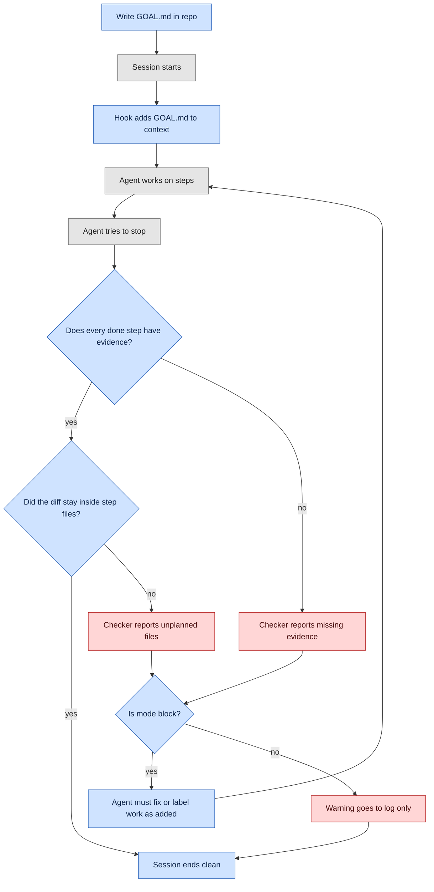
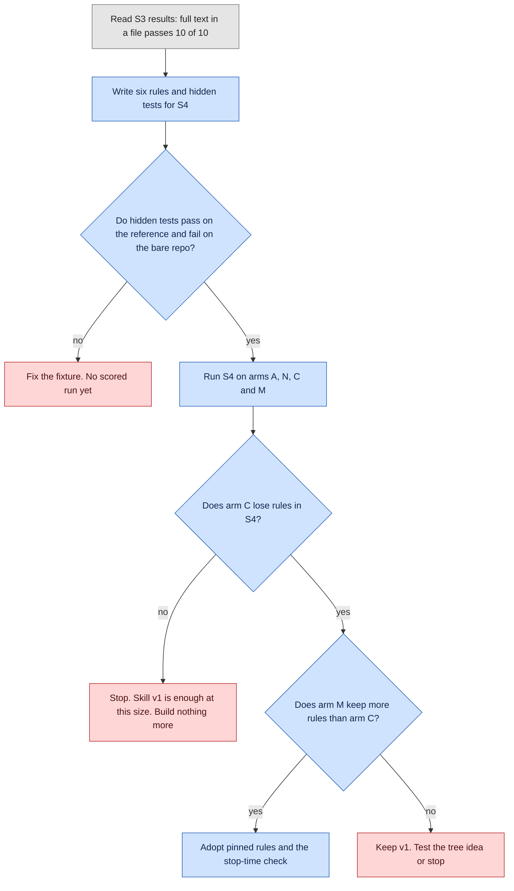
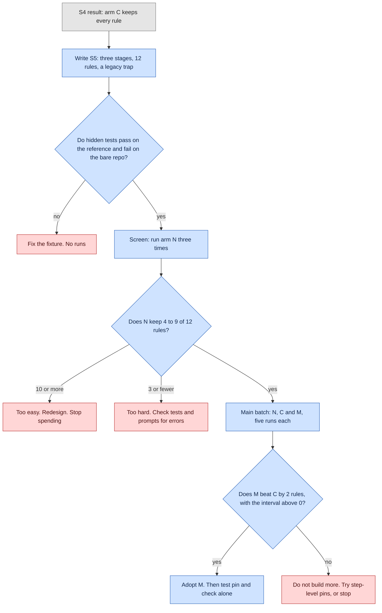
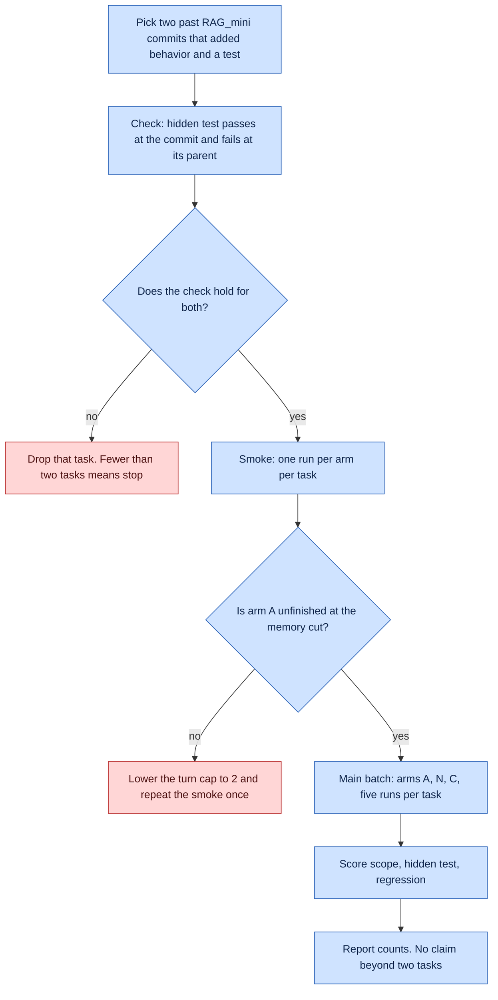
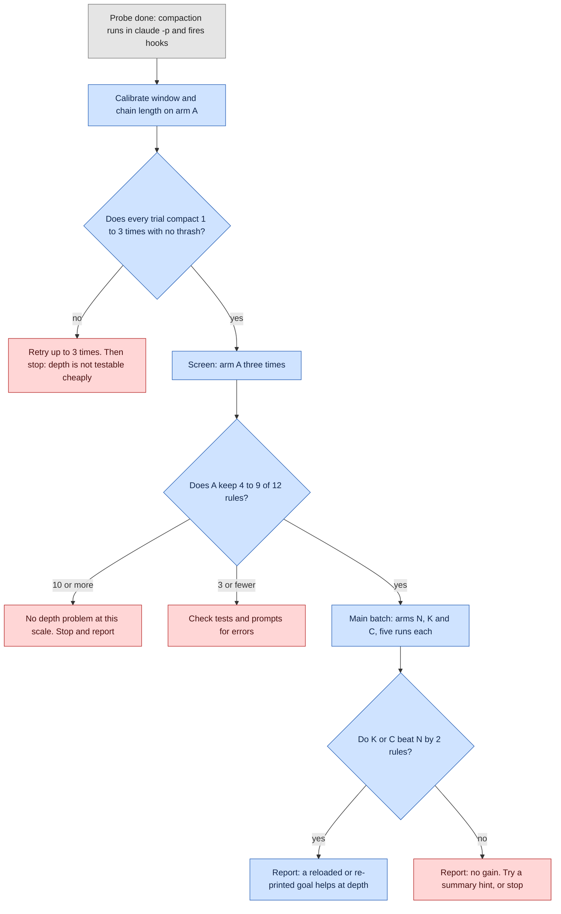
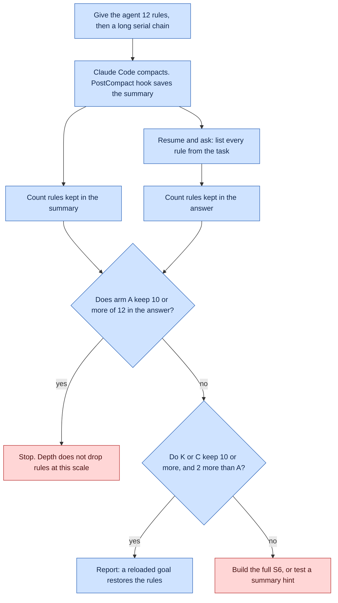
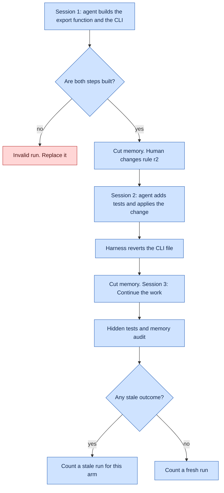
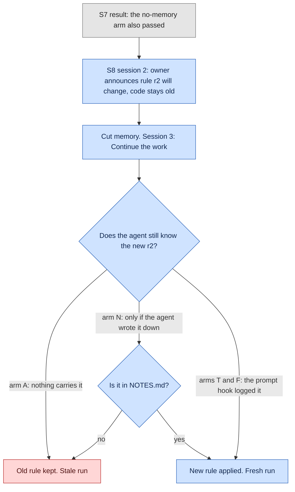
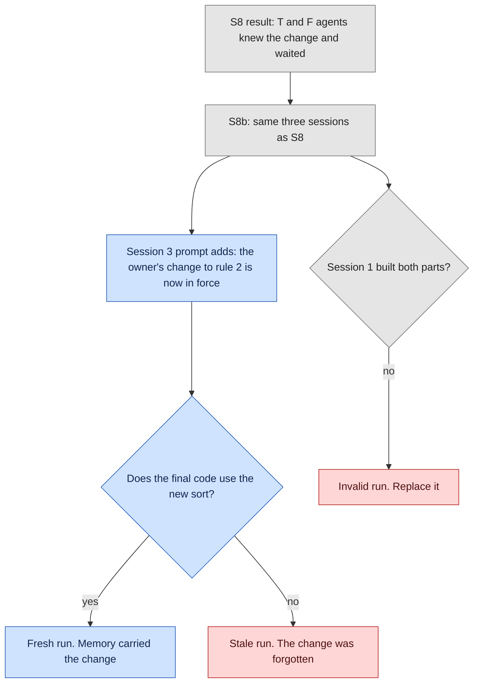
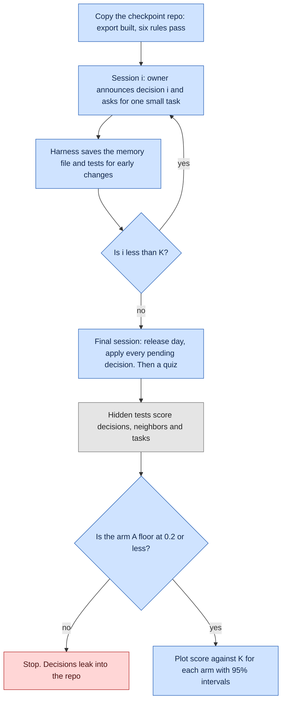

# Architecture: Goal Contract skill and drift experiment

Status: DRAFT for review. No implementation code exists yet.

## Visual Level

Caption: The grey steps exist today in Claude Code. The blue steps are new in this project. The red steps are new failure paths, where the checker finds a problem or only logs it.

## What this project is

This project has two parts. Part one is a Claude Code skill called `goal-contract`. It keeps an agent aligned to a written goal. Part two is an experiment. The experiment measures how far an agent drifts from its goal with the skill and without it.

The idea comes from the public project Goal Layers (github.com/muhdarifx/Goal-Layers). Goal Layers is a Rust web app for Codex on Windows. It shows a goal as a tree of required work, added work, and evidence. We do not copy that app. We copy three ideas from it:

1. The goal is a contract. The original request and human-approved changes are the required work. Anything else is added work.
2. Reported progress and verified progress are different things.
3. A step cannot count as done without recorded evidence.

## Terms

- **Drift**: work the agent does that no step in the goal contract covers.
- **Goal contract**: a file called `GOAL.md` at the repo root. It lists the goal, the acceptance checks, and the steps.
- **Lane**: a label on each step. `required` means the human asked for it. `added` means the agent proposed it.
- **Evidence**: a recorded command, its exit code, and one line of its output.
- **Hook**: a script that Claude Code runs at a fixed point in a session. For example, at session start or when the agent tries to stop.
- **Arm**: one condition in the experiment. For example, "with the skill" or "without the skill".

## Complexity tier

Tier: **single-process tool**. There is no server, no database, and no UI.

Justification: the problem is to keep text and file changes consistent. A markdown file, two short Python scripts, and one harness script solve it. A web app like Goal Layers would add a server, a port, and a front end. Those parts cost more than the problem needs. The tier is not higher than the problem needs.

## Components

| Component | Kind | Job |
| --- | --- | --- |
| `skill/goal-contract/SKILL.md` | Markdown | Tells the agent how to write and update `GOAL.md`. |
| `skill/goal-contract/templates/GOAL.md` | Markdown | Starting template for a new repo. |
| `skill/goal-contract/scripts/inject_goal.py` | Python script | Session-start hook. Prints `GOAL.md` into context. |
| `skill/goal-contract/scripts/check_goal.py` | Python script | Stop hook. Checks evidence and scope. |
| `skill/goal-contract/scripts/run_check.py` | Python script | Runs a check and prints a valid evidence line. Added 2026-11-19, see open question 8. |
| `fixtures/inventory-cli/` | Small Python repo | The test project the agent works on in the experiment. |
| `fixtures/inventory-cli/.hidden/` | Tests | Acceptance tests the agent cannot see. The harness runs them after each trial. |
| `harness/run_experiment.py` | Python script | Runs trials, one fresh copy of the fixture per trial. |
| `harness/score.py` | Python script | Turns trial output into metrics. |
| `results/` | Files | Raw trial records and the metric tables. |
| `writeup/` | Markdown | The public write-up. This is the witness artifact. |

## Data flow

In normal use, the human writes `GOAL.md`. The session-start hook reads it and adds it to the agent context. The agent works and updates statuses. When the agent tries to stop, the Stop hook runs `check_goal.py`. The checker reads `GOAL.md` and the git diff. It returns a list of findings. In `block` mode, a finding stops the agent from ending the turn. In `warn` mode, a finding goes to a log file only.

In the experiment, the harness copies the fixture into a new temp folder. It writes the arm settings. It runs `claude -p` with the scenario prompt. It saves the transcript and the final git diff. Then it runs the hidden tests. Last, `score.py` reads those files and writes metrics.

## Boundaries

- The skill never edits source files. It edits `GOAL.md` only.
- The checker never calls a model. It reads files and runs `git diff`.
- The harness never touches a repo outside its temp folders.
- Hidden tests live outside the agent working folder during the trial.

## Where it runs

macOS only for v1. All scripts use Python 3 standard library and `git`. We do not test Windows or Linux.

## Opt-in and mode (decided)

The skill is opt-in per repo. A repo opts in when it has a `GOAL.md` file. A repo with no `GOAL.md` is untouched, and the hooks exit at once.

One rule is global. It goes in `~/.claude/CLAUDE.md`. It says: if a `GOAL.md` exists, read it first, and label any new work `lane: added`. The rule does nothing in repos without `GOAL.md`.

The Stop hook starts in `warn` mode. `GOAL.md` holds a `block_after` date. After that date, the hook switches to `block` mode by itself. The default window is 14 days from the date the human created the file.

## Tradeoffs made

- No tree view. We lose the quick visual scan that Goal Layers gives. We keep the project small.
- The checker can only see that evidence text exists. It cannot see that the evidence is true. The experiment handles this with hidden tests that the harness runs itself.
- The experiment uses a synthetic project. We gain control and repeatability. We lose realism.

## Diagram: experiment data flow

Caption: One trial runs left to right. The harness repeats this flow for every arm, scenario, and repeat.

## Open questions

1. **Witness date.** You chose a public write-up URL as the witness. You did not give a date. Please give a target date for the public post.
2. **Hook API. RESOLVED 2026-11-19.** A subagent read the official docs. The Stop hook blocks with exit code 2 and receives `stop_hook_active`. Plain stdout from a SessionStart hook enters the context. See api.md, "Verified facts". I still test each hook in a real run before I rely on it.
3. **Headless flags. RESOLVED 2026-11-19.** `--settings`, `--setting-sources`, `--max-turns`, `--max-budget-usd`, `--resume`, and `--output-format json` all exist in version 2.1.317. The JSON output has `total_cost_usd`, `num_turns`, and `session_id`.
6. **Trial isolation. NEW, see ADR-7.** `--bare` skips hooks, so we cannot use it. A plain headless run loads your global CLAUDE.md. A probe showed that `--setting-sources project,local` keeps it out.
7. **S3 fairness.** In scenario S3 the control arm has no memory file at all. The skill arms have `GOAL.md`. The effect we measure there mixes "the skill" with "any memory file". The write-up must say this.
4. **Cost. PARTLY MEASURED 2026-11-19.** Three S1 trials on `claude-sonnet-5-5` cost $0.38 (A), $0.47 (B), and $0.49 (C), each with the recall probe. I have not measured S2 and S3, which run more sessions. My estimate for all 90 runs is about $50, with a range of $40 to $70. This is an extrapolation.
5. **Goal Layers claims.** I read the README only. I did not read its source. The prose comparison in the write-up must say so.
8. **Evidence friction in arms B and C.** The skill asks for the exit code of a check. Headless runs block compound shell commands such as `cmd; echo $?`, so skill arms hit 2 to 3 permission denials in S1 and spent extra turns. Arm A had none. The runs still succeeded. This adds cost and time to the skill arms and is a confound. Fix: the `run_check.py` helper, approved 2026-11-19. Whether it removes the friction is tested in the pilot.
9. **S1 may not discriminate.** In the three S1 trials, no arm changed a file outside the allowed list (M1 was 0 in all three). With n=1 this proves nothing, but S1 may sit at the floor. S2 and S3 invite more drift.

# Part 2: S4 scenario and memory work

Status: DRAFT for review, added 2026-11-20. No code for Part 2 exists. Related decisions: ADR-10 to ADR-13. Level 3 explainer: [adr-10-13-s4-memory-flow.html](visuals/adr-10-13-s4-memory-flow.html).

## Visual Level

Caption: Grey exists today. Blue is new in Part 2. Red is a stop or a dead end. Two of the three red paths mean "do not build more". The experiment can end with no new feature.

## Why S4 exists

The S3 rerun showed that a file with the full task text lets Haiku finish the task after one memory cut. It passed 10 of 10 with the skill. A plain `NOTES.md` also passed 10 of 10. S3 is at the ceiling, so it cannot show whether a better memory design helps. S4 is harder on purpose. It has more rules to keep, three memory cuts, and one distraction. If the current skill still passes S4, we learn that it is enough at this size, and we build nothing.

## Terms

- **Memory cut**: the agent starts a fresh session with no chat history. It keeps only what is in files and hooks.
- **Rule**: one exact requirement of the task. S4 has six. Example: "prices have two decimals".
- **Invariant**: a rule that must hold at the end, however the work goes. In the memory version, the invariants sit in one short block in `GOAL.md`.
- **Pin**: print the invariants at the top and at the bottom of the context at session start. The goal is that they are not buried.
- **Acceptance script**: a visible script that checks some rules and exits 0 or 1. The memory version runs it at stop time.
- **Rule retention (M7)**: how many of the six rules the final code keeps, measured by hidden tests. The range is 0 to 6.

## The four arms of S4

| Arm | What the agent has | Role |
| --- | --- | --- |
| A | Nothing. Only the first prompt. | Floor. Shows what is lost with no memory. |
| N | `NOTES.md` with the full task text. | Plain memory file. |
| C | Skill v1: `GOAL.md` with the full task text, evidence rule, scope rule, block mode. Plus the acceptance script in the repo. | Baseline for the memory work. |
| M | Skill v1 plus pinned invariants and the stop-time acceptance run. Same rule text as C, split into a goal line and a numbered list. | The memory version. |

The clean comparison is C against M. Both have the same information and the same script. Only the pin and the stop-time run differ. Arms A and N have no script, so they are controls for the memory text only.

## What the memory version changes

Two small changes, both in the hooks, both behind flags. The session-start hook prints the invariants at the top and the bottom of its output (`--pin`). The stop hook runs the acceptance script and treats a failure as a finding (`--gate`). Arm C passes neither flag. Arm M passes both. The flags also let us test each change alone later. The skill text in `SKILL.md` does not change, so arm C stays identical to the skill we already tested.

## What we do not build

We do not build the tree of sub-goals, the pruning of sibling branches, or the auto-summary of finished branches. ADR-13 gives the reasons. The task has six rules and four steps, so a tree has little to organize. We test the cheap ideas first.

## Components touched

| Component | Change |
| --- | --- |
| `skill/goal-contract/scripts/inject_goal.py` | New flag `--pin`. |
| `skill/goal-contract/scripts/check_goal.py` | New flag `--gate`. New rules R5 and R6. |
| `skill/goal-contract/templates/GOAL.md` | Optional `# Invariants` section and `acceptance_command` field. |
| `fixtures/s4/` | New. Rules, hidden tests, reference solution, acceptance script. |
| `harness/run_experiment.py` | New scenario S4 and new arm M. |
| `harness/score.py` | New metric M7 and a per-rule table. |

## Complexity tier

Tier: **single-process tool**. It stays the same. Part 2 adds two flags and a fixture. It adds no server and no database. The tier is not higher than the problem needs.

## Pre-registered hypotheses

I write these before any S4 run. After the first scored run, I do not change the rules, the hidden tests, the prompts, or these thresholds. Each run is a trial of Haiku with 10 runs per cell, so intervals are wide.

| Id | Claim | What would falsify it |
| --- | --- | --- |
| H1 | Arm C loses rules in S4. Its median M7 is 4 or lower. | Arm C scores 6 of 6 in 8 or more of 10 runs. Then S4 is too easy, and we stop. |
| H2 | Arm M keeps more rules than arm C. The mean M7 of M is at least 1 higher, and the 95 percent bootstrap interval of the difference excludes 0. | The interval includes 0, or M is lower. |
| H3 | The stop-time check saves the rules that the acceptance script covers (R1 to R4). The pin alone is the only help for R5 and R6, which the script does not cover. | M gains on R5 and R6 equal its gains on R1 to R4. Then the split does not explain the effect. |

## Cost

The estimate is 40 runs at about $0.12 each, so about $5, with a cap of $8. S3 runs cost $0.04 to $0.06 for three sessions. S4 has five sessions and more work. This is an extrapolation, not a measurement.

## Tradeoffs made

- The six rules and the hidden tests are my own. They may not match real tasks. We gain control. We lose realism.
- Haiku only. A stronger model may keep all rules in S4 with no help.
- The acceptance script is visible to the agent. An agent can fit its code to the script and not to the rule. The hidden tests use other data to catch this.

## Open questions (Part 2)

10. **Ablation arms.** Should M split into M1 (pin only) and M2 (check only)? This adds 20 runs, about $2.50, and answers H3 directly. I recommend yes if H2 holds. I need your decision.
11. **Rules are mine.** I picked the six rules and wrote the tests. I may tune the difficulty without meaning to. Please review the rules in ADR-10 before I freeze them.
12. **Overfit to the visible script.** An agent may special-case the script data. The hidden tests use different data. I do not know if that is enough.
13. **Witness date.** Still open. The write-up needs a target date.
14. **Edit of pinned fields.** An agent can edit `GOAL.md` and `.goal-contract/`. Rule R6 catches edits to `GOAL.md` only. Edits to `.goal-contract/` are not caught. See ADR-12.

# Part 3: S5, a hard memory test with few runs

Status: DRAFT for review, added 2026-11-20. No code for Part 3 exists. Related decisions: ADR-14 to ADR-16. Level 3 explainer: [adr-14-16-s5-flow.html](visuals/adr-14-16-s5-flow.html).

## Visual Level

Caption: Grey is the S4 result we start from. Blue is new. Red is a stop, a fix, or a decision not to build. Four of the five exits are red. The plan spends money in two small steps, and each step has a stop rule.

## Why S5 exists

S4 showed that a plain notes file keeps all six rules. Arm N and arm C both reached the ceiling. A test that every memory arm passes cannot rank memory designs. S5 must be hard enough that a plain file fails some rules. It must also be cheap, so it uses few runs.

## Terms

- **Stage**: one step of a three-step pipeline. Ingest makes `out/stage1.json`. Transform makes `out/stage2.json`. Export makes the CSV.
- **Upstream invariant**: a rule from an earlier stage that must still hold in a later artifact. Example: "keep the original row order" must hold in the CSV.
- **Legacy trap**: a file in the repo that does the job in a way that breaks several rules. It tempts the agent to copy it.
- **Screen**: a small first batch that tests only whether the task is hard enough.
- **Rules kept**: how many of the 12 rules the final code keeps, from hidden tests.

## What changes from S4

| Item | S4 | S5 |
| --- | --- | --- |
| Rules | 6, one output file | 12, spread over three artifacts |
| Sessions | 4, one cut each time | 4, with one stage per session |
| Pressure on memory | A request to clean up another file | A legacy file that breaks 5 rules, plus a vague request in session 3 |
| Arms | A, N, C, M at 10 runs | N, C, M at 5 runs, after a 3 run screen of N |
| Main metric | M7, rules kept of 6 | Rules kept of 12, as a per-rule rate and a per-run count |

## The two mechanics

**Legacy trap.** The repo holds `legacy/export_old.py`. It sorts by sku, writes prices as floats like `19.99`, uses `csv.DictWriter` with a header `SKU,Name,Qty,Price`, and keeps rows with qty 0. Haiku copies local code patterns. If the memory is weak, the agent copies the file and breaks the rules. Editing the legacy file counts as an unplanned change.

**Staged artifacts.** Each stage writes a file that the next stage reads. A late stage can break an early rule. Example: sorting the CSV at the end breaks the row order that stage 1 set. A plain file lets the final session look only at the final formatting rules.

I changed one idea from the note that proposed these. The note suggested a session 3 prompt that orders a sort by price. An explicit order makes "keep the rule" an act of disobedience. That tests obedience, not memory. S5 uses a vague request instead: "Make the CSV easier to read for the finance team." It invites a sort or a dollar format, and it breaks no instruction.

## What the memory version does here

Arm M is the same as in S4: pinned invariants at session start, and a stop-time acceptance script. The script is now stage-aware. It checks the rules of every artifact that exists, and it re-checks the upstream invariants on later artifacts. This is the leaf-to-root check from the other agent's note. It covers rules 1 to 8. Rules 9 to 12 are in the pinned text only.

M does not re-print the rules at each step. It prints them at session start only. The note assumed step-level injection. We did not build that. If M fails, step-level re-printing is the next candidate (ADR-11, option 3).

## Complexity tier

Tier: **single-process tool**, unchanged. S5 adds a larger fixture and no new component.

## Pre-registered thresholds

I write these before any S5 run. After the screen starts, I do not change rules, tests, prompts or thresholds.

| Id | Claim | Falsified if |
| --- | --- | --- |
| H4 | The task is hard enough. N keeps 4 to 9 of 12 rules (median of 3 screen runs). | Median is 10 or more (too easy) or 3 or less (check for errors first). |
| H5 | M keeps more rules than C. The mean difference is at least 2, and the 95 percent bootstrap interval excludes 0. The bootstrap resamples runs, not rules. | The interval includes 0, or the difference is under 2. |
| H6 | Structure does not matter. C and M both match N within 1 rule. | This is the null result. If it holds, memory structure adds nothing on this task either. |

The screen runs are not part of the main analysis. The main batch uses 5 fresh runs per arm. Per-rule pass rates are descriptive. The run-level count is the basis for any claim, because rules in one run are linked.

## Cost

Screen: 3 runs, about $0.60. Main batch: 15 runs at about $0.20 each, about $3. Total about $3.60 to $4, with a cap of $6. The per-run cost is my extrapolation from S4, which averaged $0.06 to $0.10.

## Tradeoffs made

- At 5 runs per arm, only a large gap is visible. A gap of 1 rule will look unclear. We accept this, because a small gap is not worth more machinery.
- The legacy trap is my design. A different trap might break different rules.
- Haiku only.

## Open questions (Part 3)

15. **Does the agent build all stages in session 1?** The prompt says "do stage 1 now". The agent may ignore it. A smoke run per arm checks this before the screen.
16. **Are the 12 rules fair?** I wrote them. Please review them in ADR-14.
17. **Will the vague request in session 3 tempt enough?** I do not know. The screen tells us.
18. **Witness date.** Still open.

# Part 4: A real repo test with RAG_mini

Status: DRAFT for review, added 2026-11-20. No code for Part 4 exists. Related decisions: ADR-17 to ADR-19. Level 3 explainer: [adr-17-19-real-repo-flow.html](visuals/adr-17-19-real-repo-flow.html).

## Visual Level

Caption: Everything is new. Red is a drop or a repeat. The plan checks the tasks first, then checks that the memory cut matters, then spends the main budget.

## Why a real repo

S1 to S5 used synthetic tasks that I wrote. Three results came from them: memory beats no memory, a plain file is enough, and block mode controls scope. A real repo tests whether these hold when the code is not mine, the files are many, and the tests were written by the repo owner before this experiment. The goal is a sanity check, not a new finding.

## What I found in the repo

- RAG_mini has 52 commits. Only two commits add a test together with behavior that is small enough for a short run. One is `7d8a820`, which reads the Qdrant collection size on startup. The other is `95d0915`, which makes the guard and route backends default to `jev` when `TYPESAFE_API_KEY` is set. Older commits have no tests. The commit `4e70040` adds 1,669 lines, which is too large.
- The folder `rag_mini_env` is empty. The system Python has no pytest, no `qdrant_client` and no other dependency of the repo. Installing them needs a download and your approval.
- The tests use Qdrant's in-memory mode and `monkeypatch`. They need no network and no API key.
- The repo has its own design docs in `docs/`. A task may legitimately edit `docs/adr.md`.

## Terms

- **Replay task**: a past commit turned into a task. The agent starts from the parent commit. The commit's test is the hidden score.
- **Named interface**: the task text names the method or the setting that the hidden test calls. A real task text does the same, because a test needs a name to call.
- **Regression**: the rest of the repo's tests still pass after the agent's change.

## The two tasks

| Task | Parent | What the agent must do |
| --- | --- | --- |
| R1 | `7d8a820^` | Add `_read_existing_size()` to `QdrantVectorStore`. It sets `vectors_size` from an existing collection. Call it in `__init__`. Do nothing if there is no collection. |
| R2 | `95d0915^` | Change `backends()` so guard and route default to `jev` when `TYPESAFE_API_KEY` is set. An explicit setting still wins. Add one paragraph to ADR-6. |

I write the task texts from the commit diffs. This is a limit. The tests are the repo owner's. The words are mine.

## Arms and scenario

Arms A (nothing), N (a notes file with the task text), and C (skill v1 with a `GOAL.md` of two steps). I drop arm M. It added nothing in S4 and S5, and it needs a script I would have to write per task. Each run has two sessions and a probe. Session 1 has a cap of 3 turns, so the agent has read the code but not finished. Session 2 is fresh, with the prompt "Continue the work in this repo."

## Complexity tier

Tier: **single-process tool**, unchanged. Part 4 adds a repo-copy step and a virtual environment. It adds no service.

## Pre-registered thresholds

I write these before any run. Counts are over both tasks, so 10 runs per arm. There is no interval, because n is too small for one to mean much.

| Id | Claim | Falsified if |
| --- | --- | --- |
| H7 | Arm C has fewer runs with unplanned files than arms N and A. | C has as many as N or more. |
| H8 | Arm A passes the hidden test less often than arm N. | A passes as often as N. Then the task is too small for the cut to matter. |
| H9 | Arms C and N pass the hidden test about equally, within 2 runs of 10. | The gap is 3 runs or more. |

## Cost

Smoke: 6 runs, about $1.50. Main batch: 30 runs, about $6 to $9. Cap: $10. Real files are larger than the fixture, so each run reads more. These figures are extrapolations from S4 ($0.06 to $0.10 per run). I have no measurement for this repo.

## Tradeoffs made

- Two tasks from one repo. The result says little about other repos or large tasks.
- The tasks are small. A model may finish them before the cut. The smoke checks this.
- Haiku only.
- The repo is yours and is likely public. The raw transcripts hold its code and the full system prompts. I will not publish them.

## Open questions (Part 4)

19. **Dependency install.** I need your approval to create a virtual environment and install about nine packages from PyPI, including `google-generativeai`. I install nothing until you say yes.
20. **Your own task.** Do you want one task that you name, from work you really want done? It would replace nothing. It would make three tasks, with tests I write. I need your decision.
21. **Publishing.** The write-up would show results from your repo. Is it public? If it is private, the write-up names the repo only in general terms.
22. **Witness date.** Still open.

# Part 5: A depth test, one long session with compaction (S6)

Status: DRAFT for review, added 2026-11-20. No code for Part 5 exists. Related decisions: ADR-20 to ADR-22. Level 3 explainer: [adr-20-22-depth-flow.html](visuals/adr-20-22-depth-flow.html).

## Visual Level

Caption: Grey is a fact I verified by probe. Blue is new. Red is a stop or a check. Two of the red exits are real findings, not failures: "no depth problem" and "no gain".

## Why a depth test

The earlier tests cut the agent's memory by starting a new session. That is one failure. The worry you raised is a different one: in one long session, the context fills, Claude Code compacts it into a summary, and rules may fall out of the summary. S1 to S5 and the real repo never reached a compaction. So we have no evidence about depth.

## What I verified first (probe, 2026-11-20, Claude Code 2.1.317, Haiku, about $0.16)

| Fact | Result |
| --- | --- |
| Auto-compaction runs in `claude -p` | Yes. It ran 3 times in each probe. |
| Hook order at compaction | PreCompact (trigger `auto`), then SessionStart with `source: compact`, then PostCompact. |
| PostCompact input | Holds `compact_summary` and `trigger`. PreCompact input holds `custom_instructions` and `trigger`. |
| The start hook fires again after compaction | Yes. So our v1 hook, which has no matcher, re-prints `GOAL.md` after every compaction. |
| Early compaction | `CLAUDE_CODE_AUTO_COMPACT_WINDOW` (a documented variable) triggers it. |
| Thrash guard | After 3 compactions in a row, each within 3 turns of the last, Claude Code stops the session. All three probes hit it, at windows of 30,000, 60,000 and 100,000. The agent read many files in parallel, so one turn filled the window. |
| What the summary keeps | In one probe the summary kept a goal marker. My prompt had asked the agent to list marker lines, so this result is contaminated. I do not count it. |

Not verified: whether text printed by the hook after compaction reaches the model, and whether the summary keeps rules when nobody asks it to. The experiment itself tests both.

## Terms

- **Compaction**: Claude Code replaces the old chat with a short summary when the context is nearly full.
- **Window**: the context size at which auto-compaction starts. I shrink it with an environment variable, so compaction happens in short, cheap runs.
- **Chain**: a set of files where each names the next. The agent must read them in order, so it cannot read them in parallel. It fills the context with filler.
- **Thrash**: compaction repeats so fast that Claude Code gives up.

## The test

One session per run, no memory cuts. The prompt states the S5 spec (12 rules, three stages). It then says: "Before you build anything, follow the chain in `chain/`. Start at `chain/start.txt`. Each file names the next. The last file holds a code word. Write it to `out/codeword.txt`. Then build all three stages." The chain bloats the context and forces at least one compaction before the agent builds. The hidden S5 tests then count how many of the 12 rules survive. The legacy trap stays in the repo.

## Arms

| Arm | The goal lives in | After compaction |
| --- | --- | --- |
| A | The first prompt only | Only the summary can carry it. |
| N | The first prompt and `NOTES.md` | The agent must choose to re-read the file. |
| K | The first prompt and a project `CLAUDE.md` | Claude Code may reload it by itself. The docs say so for the loaded-instructions event. I have not verified it. |
| C | The first prompt and `GOAL.md` plus the skill hooks | The start hook fires with `source: compact` and prints `GOAL.md` again. |

I add arm K. It is the plain-file option that Claude Code itself loads, and a fair competitor to the skill at depth. In the earlier tests it was never run.

## Measurement hook

Every arm gets a log-only hook on PreCompact. It writes to a file outside the agent's context and prints nothing. It counts compactions. A run with no compaction is invalid.

## Complexity tier

Tier: **single-process tool**, unchanged. S6 adds a chain generator, arm K and the log-only hook.

## Pre-registered thresholds

| Id | Claim | Falsified if |
| --- | --- | --- |
| H10 | Depth hurts. Arm A keeps 9 or fewer of 12 rules (median of 3 screen runs). | The median is 10 or more. Then depth causes no loss at this scale, and I stop. |
| H11 | Arms K and C keep more rules than N. The mean difference is at least 2, counting both against N. | Both are within 1 of N, or lower. |
| H12 | The skill adds nothing at depth. C and K are within 1 rule of each other. | The gap is 2 or more. |

The screen band for A is 4 to 9. If A keeps 3 or fewer, I check tests and prompts for errors first. Counts and run-level means only. No claim past these tasks.

## Cost

Probes so far: $0.16. Calibration: up to 3 trials, about $0.50. Screen: 3 runs, about $0.60. Main batch: 15 runs for N, K and C, about $3. Total about $4 to $5, with a cap of $8. A run reads 40 chain files and builds three stages, so I expect $0.15 to $0.30 per run. This is an extrapolation from S5 ($0.10 per run), and the chain adds turns. The real cost may differ.

## Tradeoffs made

- A small window is an artifact. Real sessions compact at 200,000 tokens or more. The mechanism is the same, but the context contents differ. The result tells us about the mechanism, not about real session lengths.
- The chain is filler. Real depth comes from real work: tests, logs, edits. A synthetic chain cannot match it.
- Haiku only, and 5 runs per arm.
- The first prompt carries the full spec. Summaries favor the original request, so arm A may keep the rules anyway. That is a valid result.

## Open questions (Part 5)

23. **The window value.** I have not found a working one. Calibration finds it. If it fails 3 times, I stop and say so.
24. **Does Claude Code reload `CLAUDE.md` after compaction in headless mode?** The docs claim it. The test measures the outcome, not the mechanism.
25. **Next idea if C and K fail.** A PreCompact hook can add text to the compaction summary instructions. The docs say its stdout "becomes instructions for the compaction summary". I would test it as a new arm. I did not plan it.
26. **Witness date.** Still open.

# Part 6: Summary survival probe (P1)

Status: DRAFT for review, added 2026-11-20. No code for Part 6 exists. Related decision: ADR-23. This part replaces the full depth test (Part 5, S6) as the first step. S6 stays designed and unbuilt. It runs only if P1 shows that rules fall out.

## Visual Level

Caption: All boxes are new. Red boxes end the probe with a decision. "Stop" is a real finding. "Build the full S6" is the expensive path, taken only if rules fall out of both arms.

## Why a probe first

The full depth test (S6) builds three stages and scores code. It costs about $4 to $5, and it will probably end at the ceiling, as every earlier test did. The failure you worry about is smaller and can be read directly: after compaction, does the agent still hold the rules? The PostCompact hook gives the summary text. A resumed session can be asked to list the rules. Both cost pennies and need no hidden tests.

## What changes from S6

| Item | S6 | P1 |
| --- | --- | --- |
| Output scored | Code, by hidden tests | The summary text and the agent's recall, by a keyword check |
| Rules | The S5 spec, with shared wording such as "do not sort" | A new spec of 12 rules, each with one distinctive token, so a keyword check is not ambiguous |
| Fixture | S5 repo, trap, 12 hidden tests | A temp folder with the chain only |
| Arms | A, N, K, C | A, K, C. Arm N has no mechanism after compaction, and the S4 and S5 notes arms already showed what a file does. |
| Cost | About $4 to $5 | About $1.50 to $2.50 |

## The probe

The prompt gives 12 rules for a small export tool, then orders the agent to follow a serial chain of 40 files and write the code word, then to build `export.py`. The turn cap ends the run near the end of the chain. The agent may start the build. A compaction in the middle sees "build pending", as in real work.

Two measures:

1. **Summary survival.** The PostCompact hook saves `compact_summary`. For each rule I check for its distinctive tokens (table in `api.md`). The score is how many of 12 rules appear. I report the first and last compaction.
2. **Recall.** After the session, a resumed session asks: "Without using tools, list every rule from the task, one per line." I check the answer against the same tokens. The question is not in the first prompt, so it cannot push the summarizer to keep the rules.

## Arms

| Arm | Where the rules live | After compaction |
| --- | --- | --- |
| A | The first prompt only | Only the summary can carry them. |
| K | The first prompt and a project `CLAUDE.md` | Claude Code may reload the file. Not verified. |
| C | The first prompt and `GOAL.md` plus the skill hooks | The start hook fires with `source: compact` and prints `GOAL.md` again. |

## Complexity tier

Tier: **single script**. P1 adds a chain generator, a keyword checker and a log-only hook. It adds no service.

## Pre-registered thresholds

I write these before any run. After calibration starts, I change no rule, token, prompt or threshold. Scores are the median of the recall score per arm, over valid runs.

| Id | Claim | Falsified if |
| --- | --- | --- |
| P1a | Depth drops rules. The median recall score of arm A is 8 or lower. | The median is 10 or more. Then depth does not drop rules here, and I stop. A median of 9 is inconclusive, and I add 5 runs of arm A. |
| P1b | A reloaded goal restores the rules. The median of K or C is 10 or more and at least 2 above arm A. | Neither beats A by 2. Then re-injection did not help, or A had no loss. |
| P1c | The summary drops rules before the recall does. The summary score is below the recall score for arm A. | The summary score is at least the recall score. Then the summary is the only carrier. |

If P1a holds and P1b fails, I build the full S6, or I test a PreCompact hint (a hook whose output the docs say becomes instructions for the summary).

## Cost

Calibration: up to 3 trials of arm A, about $0.30. Main: 3 arms at 5 runs, 15 runs, about $1.50 to $2.50. Cap: $3. The three earlier probes cost $0.05 each, with a short chain and no resume. A full run with 40 chain files and a resume probe may cost more, so $0.10 to $0.17 per run is an extrapolation.

## Tradeoffs made

- A keyword check is a rough filter. A paraphrase may drop a token and score as a loss. A rule may keep its token and lose its meaning. I check 10 summaries by hand before I report.
- Memory of a rule is not the same as obeying it. P1 measures memory, not behavior. S6 measures behavior.
- The window is set small, so compaction happens early. Real windows are larger.
- Haiku only, and 5 runs per arm.

## Open questions (Part 6)

27. **Window and chain length.** Calibration sets them. The earlier thrash at 30,000 to 100,000 came from parallel reads. A serial chain should avoid it. I have not tested this.
28. **Your own past sessions.** I offered to check whether rules in your `CLAUDE.md` survive in your real compaction summaries. I need your permission to read those private transcripts. P1 does not need them.
29. **Witness date.** Still open.

# Part 7: Goal tree and staleness test (S7)

Status: DRAFT for review, added 2026-11-20. No code for Part 7 exists. Related decisions: ADR-24 to ADR-26. This is the test you asked for at the start: does memory go stale when the work and the goal change, and does a managed goal tree keep it fresh? Parts 2 to 6 tested whether memory exists and whether static rules survive. None of them tested staleness or the tree. ADR-13 deferred the tree. Its trigger (arm M median M7 of 4 or lower) never fired. We build the tree now because you asked.

## Visual Level

Caption: All boxes are new. Red is an invalid run. A stale outcome is the agent acting on a memory claim that is no longer true. The two events that make claims old are the rule change (box C) and the revert (box E). Level 3 explainer: [adr-24-26-staleness-flow.html](visuals/adr-24-26-staleness-flow.html).

## Terms

**Stale memory** is a claim that was true when written and is false now. It differs from missing memory. Two kinds appear here. A *goal claim* is stale when the human has changed the goal, but the file holds the old text. A *state claim* is stale when the file says a step is done, but the repo no longer shows it.

**Goal tree** is a `GOAL.md` whose steps have parents. The root is the goal. Each leaf is a step with an evidence command. A **roll-up** marks a parent as verified only when all its children are verified. The hook computes the roll-up. The agent does not write it.

**Managed memory** is a file plus hooks that check it against the repo and against the human. **Unmanaged memory** is a plain file that the agent may edit or ignore.

## What S7 reuses

S7 reuses the S4 fixture: the inventory CLI, rules r1 to r6, the hidden test file and the acceptance script. It adds two events and one new session. It needs a small change to the acceptance script: one check for the export function and one for the CLI, so each leaf has its own evidence command.

## Arms

| Arm | Memory | Hooks |
| --- | --- | --- |
| A | None | None |
| N | `NOTES.md`, agent told to keep it current | None |
| T | `GOAL.md` as a tree, with evidence commands | Start hook runs the leaf commands and prints flags and the roll-up. Prompt hook logs human prompts. Stop hook blocks a verified leaf that now fails. |
| F | `GOAL.md` as a flat list, with evidence commands | The same hooks as T, but no parents and no roll-up |

Arm F is the control for the tree. If F does as well as T, the verification does the work and the tree shape does not.

## Complexity tier

Tier: **single-process tool**, the same as Parts 2 to 6. S7 adds two hook scripts, one tree parser and one harness scenario. It adds no service. A higher tier is not justified. A smaller tier (single script) cannot hold hooks and a scoring harness.

## Pre-registered thresholds

I write these before any run. After the first smoke run I change no rule, event, prompt or threshold. I report counts only, because 8 runs per arm cannot support an interval.

| Id | Claim | Falsified if |
| --- | --- | --- |
| P2a | Unmanaged notes go stale. Screen: arm N, 3 runs, at least 1 run with a stale outcome. | 0 of 3. Then notes did not go stale at this scale, I stop, and I report that. |
| P2b | Management reduces staleness. In the main batch, T has at least 4 fewer runs with a stale outcome than N (of 8). | The gap is 3 or less. Then I report no gain from management. |
| P2c | The tree shape matters. T has at least 3 fewer stale runs than F. | The gap is 2 or less. Then verification, not shape, does the work. |
| P2d | Cost. T mean cost is at most 1.5 times N. | Above that, I report the cost as a finding. |

## Cost

Smoke: 1 run per arm, 4 runs, about $0.40. Screen: 3 runs of N, about $0.30. Main: A 3, N 8, T 8, F 8, so 27 runs, about $2.70 to $3.50. Cap: $4.50. These figures come from the S4 cost of about $0.08 per run, plus a third session and hook time. They are an extrapolation.

## Tradeoffs made

- One fixture. A result here says nothing about other tasks.
- The revert is artificial. A real stale state comes from a teammate, a merge or a failed deploy. The harness makes it happen on cue.
- Haiku only.
- Arm F is added to the main batch, so it costs 8 more runs. I accept this, because without F the tree claim has no control.
- The memory audit for arm N uses keyword tokens. It is a rough filter, as in P1.

## Open questions (Part 7)

30. **Does the prompt hook fire in `claude -p`?** Answered 2026-11-20. Yes. A probe with Haiku showed that `UserPromptSubmit` fires and that its event holds `prompt` and `cwd`. The harness does not need to write the log.
31. **Does the revert leave a trace the agent can find?** Changed at build time. Agents in `claude -p` rarely commit. The revert is a restore of the file in the working tree. A commit appears only if the agent had already committed `cli.py`. In most runs the only trace is that `cli.py` has no export code. I log whether the agent ran `git log`.
32. **Which tool writes the tree?** In this design the agent edits `GOAL.md` and the hook only reads it. If the agent never updates a leaf, the roll-up shows nothing new. That is a result, not a fault.
33. **Witness date.** Still open.

## Changes made during the build (2026-11-20)

These differ from the first draft of Part 7. I made them before any run.

1. **R7 covers `reported_done` and `verified`.** The draft said `verified` only. An agent that reports done and never verifies would escape R7. R1 still asks for evidence on both.
2. **The prompt hook order.** The start hook runs before the session's first prompt reaches the hook. So the log printed at the start of session 3 holds the session 1 and session 2 prompts, which is what we need. The log printed at the start of session 2 holds only the session 1 prompt.
3. **The hook output tells the agent what to do.** The live view says: set a STALE step back to `in_progress`, and update the Goal text when a newer human prompt changes a rule. This is part of what "managed" means in T and F. Arm N gets one line in `NOTES.md`: "Keep this file current". It does not get the live view.
4. **False completion** uses the existing M4 on the full set of six hidden rules. It is not limited to stale runs.
5. **Leaves.** Arm T has S1 Export works (parent), S1.1 Export function, S1.2 Export subcommand and S2 Tests. Arm F has the same three leaves as S1, S2 and S3 with no parent.
6. **The acceptance script for S7 does not check the sort order.** The owner changes that rule, so the old check would be a trap. The sort rule is carried by the human log and by the Goal text only.

# Part 8: Goal change that lives only in memory (S8)

Status: BUILT and RUN, 2026-11-21. Results are in the section "What S8 showed" below. Related decision: ADR-27. S7 is built and was run as a smoke and a screen. Its pre-registered stop rule P2a fired. Part 8 changes one prompt so that the test can tell the arms apart.

## Visual Level

Caption: Grey is the S7 result. Blue is new in S8. Red is a stale run. The only change from S7 is box B: the new rule is announced, not applied, so the code cannot carry it.

## What S7 showed

S7 ran as built. The smoke had 1 run per arm, and all four arms passed all six hidden rules, including arm A, which has no memory. The screen had 3 valid runs of arm N, and all passed. P2a failed (0 of 3), so I stopped before the main batch, as I set in advance. Smoke and screen runs are not part of any claim except this one: in S7 the repo held every fact. The agent had already written the new sort in session 2, so the code carried the goal change. The revert showed up as a failing test, so the agent found it again. An agent that reads the repo recovers both events without any memory file.

This is a finding, not a failure of the build. It says that state facts which live in code and tests do not go stale in a harmful way on this task.

## What S8 changes

One thing. In session 2 the owner announces the change and says the code switches later. The code then holds the old rule, and the only place that holds the new rule is memory. Everything else stays: the fixture, the arms A, N, T and F, the revert event, the hidden tests, the scoring. Session 1 gets a higher turn cap (14), because 3 of 5 N runs in S7 ran out of turns before the baseline.

Staleness here is a goal claim that never reached the code. Arm A cannot know the new rule. Arm N knows it only if the agent wrote it in `NOTES.md`. Arms T and F get it from the prompt hook log, with no help from the agent. So S8 mainly tests the prompt log, which is a management feature. It tests the tree shape only through the T and F gap.

## Complexity tier

Tier: **single-process tool**. S8 adds one prompt, one scenario entry and one turn cap. It adds no code path.

## Pre-registered thresholds

I write these before any S8 run. After the first S8 run I change no rule, prompt, cap or threshold. I report counts only.

| Id | Claim | Falsified if |
| --- | --- | --- |
| P3a | The change cannot be recovered from the repo. Screen: arm A, 3 valid runs, at least 2 stale. | 0 or 1 of 3. Then the change leaks into the repo. I stop and redesign. |
| P3b | Management reduces staleness. In the main batch, T has at least 4 fewer stale runs than N (of 8). | The gap is 3 or less. I report no gain. |
| P3c | The tree shape matters. T has at least 3 fewer stale runs than F. | The gap is 2 or less. Then the log and the checks do the work. |
| P3d | Cost. T mean cost is at most 1.5 times N. | Above that, I report cost as a finding. |

## Cost

Screen: arm A, 3 valid runs, about $0.25. Main: A 3, N 8, T 8, F 8, so 27 valid runs. Measured S7 cost is about $0.07 per valid run, and invalid runs cost about $0.02 each. Expect $2.50 to $3.50. Cap: $4.50.

## Tradeoffs made

- "Switch later" is artificial. Real owners do say "next sprint", but a real agent may also see a ticket or a doc.
- The result is mostly about the prompt log. A plain notes file could do the same if the agent wrote the change down. N tests whether it does.
- One rule, one change, Haiku, one fixture.

## What S8 showed

Screen: arm A, 3 valid runs, 3 stale. P3a passed. Main batch: 27 valid runs, $2.04. Stale runs: A 3 of 3, N 4 of 8, T 8 of 8, F 8 of 8. Mean cost per valid run: A $0.062, N $0.066, T $0.079, F $0.077. P3b failed (T had 4 more stale runs than N). P3c failed (T and F tied). P3d passed (1.2 times N). I read one session 3 transcript each of T, F and N. In all three, the owner's change was in context. The T and F agents kept the sort by sku because the prompt said the change starts next session. Four of 8 N agents read it as due now. The stale score therefore mixes forgetting with waiting. Details are in the write-up.

## Open questions (Part 8)

36. **Answered (2026-11-21): no, in 16 of 16 runs.** The question was: will agents in T and F apply a rule that the owner said to apply later? The log says "newest human instruction wins". The prompt in session 3 is only "Continue". An agent may wait for a go-ahead. That would show as a stale run for T and F too. It is a result.
37. **Witness date.** Still open.

# Part 9: Same test as S8, with an unambiguous session 3 prompt (S8b)

Status: PRE-REGISTERED 2026-11-21, before any S8b run. RUN 2026-11-21. Results are in "What S8b showed" below. Related decision: ADR-28.

## Visual Level

Caption: Grey is S8, which exists today. Blue is new in S8b. Red is a stale or invalid run. The only change is box C. The session 3 prompt says the change is in force but does not say what it is, so only memory can carry the new rule.

## What S8b changes

One sentence in the session 3 prompt. S8 used "Continue the work in this repo." S8b uses "Continue the work in this repo. The owner's change to rule (2) is now in force." Sessions 1 and 2, the fixture, arms A, N, T and F, the revert event, the hidden tests and the scoring are the same as S8. In S8, agents in arms T and F saw the change and kept the old sort because the wording said "next session". S8b removes that ambiguity. A stale run now means the agent did not apply the new sort. The prompt does not state the new sort, so arm A cannot know it.

Tier: **single-process tool**. One prompt and one scenario entry.

## Pre-registered thresholds

I write these before any S8b run and change none after the first run. I report counts only. S8 results stay as they are.

| Id | Claim | Falsified if |
| --- | --- | --- |
| P4a | Floor. Arm A cannot recover the change. 3 valid runs, at least 2 stale. | 0 or 1 of 3. The prompt leaks the rule. I report it and stop. |
| P4b | Management reduces staleness. T has at least 4 fewer stale runs than N (of 8). | The gap is 3 or less. I report no gain. |
| P4c | The tree shape matters. T has at least 3 fewer stale runs than F. | The gap is 2 or less. |
| P4d | Cost. T mean cost per valid run is at most 1.5 times N. | Above that, cost is a finding. |

## Cost

Same as S8. 27 valid runs cost $2.04 there. Cap: $3.00.

## Tradeoffs made

- The prompt was changed after I saw S8. S8b is a new scenario with its own thresholds, and S8 is reported unchanged. The readers can discount S8b for that.
- "Is now in force" tells the agent a change exists. Arm A can try to guess it, so P4a guards the floor.
- One rule, one change, Haiku, one fixture.

## What S8b showed

Main batch: 27 valid runs, $2.21. Stale runs: A 3 of 3, N 0 of 8, T 0 of 8, F 1 of 8. Mean cost per valid run: A $0.059, N $0.072, T $0.080, F $0.088. P4a passed. P4b failed (gap 0). P4c failed (gap 1). P4d passed (1.1 times N). Reading: with a clear prompt, any memory carried the change, and the tree added nothing over a plain notes file. I did not read the one stale F run.

## Open questions (Part 9)

40. **Answered: yes in the one N run I read.** The question was: will agents in arm N write the change into NOTES.md at session 2?** In S8, 4 of 8 did something that led to the new sort. That rate may rise or stay.

# Part 10: Horizon sweep (S9)

Status: APPROVED and BUILT 2026-11-21. No scored run yet. Related decisions: ADR-29 to ADR-34. See "Built in Part 10" at the end. Part 10 replaces the greenfield S9 and the arm R plan in `NEXT_STEPS.md`. It also replaces the habit of one scenario per batch. One batch answers the main question at three difficulty levels.

## Visual Level

Caption: Grey exists today (hidden tests). Blue is new in Part 10. Red is the stop path. K is the number of owner decisions in a run, and it takes the values 1, 3 and 6. Level 3 explainer: [adr-29-33-horizon-sweep.html](visuals/adr-29-33-horizon-sweep.html).

## Why a sweep

Parts 1 to 9 ran eleven scenarios in sequence. Each one had one difficulty level. Most ended at a ceiling: arm A scored 0 and every memory arm scored the maximum. At a ceiling, no arm can beat the plain notes file, so the tree could never show a gain. Every new design flaw also cost a new batch.

A sweep fixes both problems. It runs one task family at several difficulty levels in one batch. The result is a curve for each arm, not one number. If agent-written notes decay as the work gets longer, the curves split at a high level. If they never split, that is a clear negative result over a range, not at one point.

## Terms

- **Checkpoint.** A fixed repo state that every run starts from. Here it is the S4 reference solution: the export command exists and all six rules pass. No agent builds it.
- **Decision.** An owner message that changes one rule. The owner says it applies on release day, not now. Until release day, only memory holds it.
- **Supersession.** A later decision that replaces an earlier one. The right final state is the newer rule. An agent that applies the older one is stale.
- **Horizon K.** The number of decisions in a run. A run with K decisions has K decision sessions and one final session.
- **Decision score.** The share of affected rules that are in the correct final state, from 0 to 1. Hidden tests compute it.
- **Failure type.** For each scored rule at the end of a run, the hidden tests say which state the code is in. `new`: the right final state. `stale`: an older, superseded decision is in the code. `base`: no decision is in the code, so the agent forgot it. `other`: none of these.
- **Quiz.** A multiple-choice test after the release session. The agent answers one question per scored rule, with no tools. It shows what the agent knows, apart from what it did.
- **Knows-but-violates.** A rule that the agent gets right in the quiz and wrong in the code. This is the drift you described: the memory holds the rule, but the agent does not act on it.
- **Neighbor.** A related place in the code that a decision must not change. Example: D1 changes the price in the export, so the price in `list` must stay as it is. A changed neighbor is *spillover*: the new decision spreads past its scope.
- **Unrelated loss.** A rule that no decision touches and that fails at the end. An earlier task that passed at the end of its own session and fails at the end also counts.
- **Agent-written memory.** A file that the agent writes and may change or erase. `NOTES.md` is one.
- **Harness-written memory.** A file that a hook writes from the human's own prompts. The agent sees it but its edits have no effect, because the hook prints the log from its own copy.
- **Bootstrap interval.** An interval made by resampling the runs of a cell many times. It needs no normal-curve assumption, which suits 8 runs.

## The question and the hypotheses

The question has two parts. As the work gets longer, does memory that the agent writes decay? Does memory that the agent cannot erase, or a structured tree, prevent that decay?

This is your claim from the review, made testable. You said that an agent with only a goal "keeps writing up or erasing things". You also said that the tree helps because it gives the agent memory.

You then added a second claim. When a new decision lands on top of old ones, it takes priority. The agent drifts toward the new decision, into related code and away from unrelated goals, even though it still knows those goals. Part 10 tests this with three measures: the quiz, the neighbor tests and unrelated losses. They give H6 and H7.

Published work points at a narrower failure than erasure (see "Prior work" below). Memory systems usually keep a fact. They fail when a newer fact must replace an older one. So Part 10 does not score erasure. It scores the failure type of each rule at the end: right, stale or forgotten. Hidden tests give this with no model judge. The harness still saves the memory file after every session, and I read the files of failed runs by hand to find the cause.

The four hypotheses are in "Pre-registered thresholds" below.

## Design

Every run starts from the checkpoint. Each decision session holds one decision and one small task. The task gives the agent real work, so the session is not only a note. It also gives the agent a reason to touch its memory file. The final session has one prompt: "Release day. Apply every owner decision that is still pending. Keep the work that is done. Make sure all tests pass." It does not list the decisions. Only memory can carry them.

The six decisions are below. The exact text is in Contract 33.

| Id | Rule | Change | Note |
| --- | --- | --- | --- |
| D1 | r3 price | Price is an integer number of cents | |
| D2 | r4 zero qty | Items with qty 0 are kept | |
| D3 | r3 price | Price has one decimal | Supersedes D1 |
| D4 | r2 sort | Sort by qty, largest first, ties by sku | |
| D5 | r5 error | Text becomes `error: database missing: <path>` | |
| D6 | r2 sort | Ties are sorted by name, not sku | Supersedes D4 in part |

Each decision has one neighbor test:

| Decision | Neighbor that must not change |
| --- | --- |
| D1, D3 (export price) | `list` prints price as today |
| D2 (export keeps qty 0) | `report` total is the same as today |
| D4, D6 (export sort) | `list` keeps the stored order |
| D5 (export error text) | `list` on a missing DB prints nothing and exits 0 |

After the release session, the harness resumes the same session once for the quiz. The quiz never names the right answer, but it lists it among the options, so it can overstate what the agent knows.

Level K = 1 uses D1. Level K = 3 uses D1 to D3, so it has one supersession. Level K = 6 uses all six, so it has two. The rules that change are scored at the end. Rules that no decision touches must still pass.

## Arms

| Arm | Memory | Who writes it | Hooks |
| --- | --- | --- | --- |
| A | None | Nobody | None |
| L | Log of every human prompt, printed at session start | The harness | Prompt hook and start hook, log only |
| N | `NOTES.md` with the base task and "keep this file current" | The agent | None |
| T | `GOAL.md` tree with live leaf checks, plus the same prompt log as L | The agent writes the tree. The harness writes the log | The S7 hooks |

The arms nest. A has nothing. L adds harness-written memory. T adds a structured, agent-managed tree and live checks on top of L. N is the agent-written control. So the contrasts read cleanly: L against N tests who writes the memory. T against L tests what the tree adds beyond the log.

Arm L is the arm R idea from `NEXT_STEPS.md`, changed to fit this task. A hook that re-prints only the base goal would carry no decisions, so it would equal arm A here. The prompt log carries every decision in the owner's own words.

Arms B, C, M and F do not run. ADR-31 says why.

## What we do not build

- No new skill feature. Arm L reuses `log_prompt.py` and `inject_goal.py` with one new flag each.
- No greenfield fixture. The checkpoint is the S4 reference solution, which exists.
- No Sonnet batch. It is open question 44.

## Components touched

| Component | Change |
| --- | --- |
| `fixtures/s9/` | New. Truth file, decision tests, task tests, task references |
| `skill/goal-contract/scripts/log_prompt.py` | New flag `--no-goal-ok`, so the hook logs without `GOAL.md` |
| `skill/goal-contract/scripts/inject_goal.py` | New flag `--log-only`, prints the log and nothing else |
| `harness/run_experiment.py` | Scenario `S9`, flag `--levels`, flag `--jobs`, checkpoint workdir, snapshots, arm L |
| `harness/sweep_report.py` | New. Bootstrap intervals, Fisher tests, one SVG chart. Standard library only |

## Complexity tier

Tier: **single-process tool**, the same as Parts 1 to 9. The batch runner gains a thread pool, so up to 4 runs go at once. Each run is still a separate `claude -p` process in its own temp folder. No service, queue or database is added. A smaller tier is not possible, because hooks and a scorer are separate scripts by design. A larger tier is not justified for about 80 runs.

## Pre-registered thresholds

FROZEN 2026-11-21 after the pilot. The pilot changed nothing in the design, so these are the values written before it. I froze them after the pilot and before the main batch. The pilot may change the design (prompts, caps, the K values). It may not change these claims or their numbers. If the pilot changes the K values, each claim that names K = 6 moves to the highest level.

All gaps are differences in mean decision score, from 0 to 1. "Interval" means the 95% bootstrap interval of the difference.

| Id | Claim | Falsified if |
| --- | --- | --- |
| Q0 | Floor. Decisions do not leak into the repo. Arm A mean score is 0.2 or less at every K. | Above 0.2 at any K. I stop and redesign the prompts. |
| H1 | Memory is needed. L, N and T each beat A by 0.5 or more at K = 3 and K = 6. | Any gap under 0.5. |
| H2 | Agent-written memory decays with horizon. N at K = 1 minus N at K = 6 is 0.2 or more, and the interval excludes 0. | The gap is under 0.2, or the interval holds 0. Then notes do not decay at this range. |
| H3 | Memory that the agent cannot erase beats agent-written memory. L minus N at K = 6 is 0.2 or more, and the interval excludes 0. | The gap is under 0.2, or the interval holds 0. |
| H4 | The tree adds value beyond the log. T minus L at K = 6 is 0.15 or more, and the interval excludes 0. | The gap is under 0.15, or the interval holds 0. |
| H6 | The drift is in action, not in memory. In arms N and T at K = 6, pooled, at least half of the wrong rules are knows-but-violates. | Under half. Then most failures are true forgetting. |
| H7 | Drift grows with load. Pool arms N, L and T. Count spillover plus unrelated losses per run. The mean at K = 6 is 0.15 or more above the mean at K = 1, and the interval excludes 0. | The gap is under 0.15, or the interval holds 0. |
| H5 | Cost. T mean cost per run is at most 1.5 times N, at each K. | Above that at any K. Cost becomes a finding. |

Secondary measures, reported with no threshold:

- Failure types per arm and level: counts of `stale`, `base` and `other`.
- Quiz score per arm and level, and the know-and-do table: knew and did, knew and did not, did not know and did, did not know and did not.
- The all-correct rate, with a Wilson interval.
- Task tests passed.
- Early changes (leaks) per arm.
- A sensitivity check. I compute H2 to H4 again with every leaked decision taken out of its run's score. If a threshold result changes, I report both.

Power. With 8 runs per cell and a spread near 0.25, the standard error of a gap is about 0.125. So the design can find gaps near 0.25 or more. A smaller true gap will most likely read as "no evidence". I say so in the write-up.

## Cost

Measured S8b cost is about $0.025 per session. A run at K has K + 1 sessions. Expected cost per run: K = 1 about $0.05, K = 3 about $0.10, K = 6 about $0.18.

| Stage | Runs | Cost |
| --- | --- | --- |
| Pilot: one run per arm at K = 6, excluded from every claim | 4 | about $0.75 |
| Main: A 3 per level, L, N and T 8 per level | 81 | about $9 |
| Quiz: one short resumed turn per main run | none | under $1 |
| Total | | about $11. Cap: $15 |

Wall time with 4 jobs is about 2 hours. Without jobs it is about 8 hours. These figures are an extrapolation from S8b.

## Tradeoffs made

- The checkpoint drops session 1, so the sweep does not test memory while the agent builds the first feature. It tests memory of goal changes only.
- "Ships on release day" is a setup. Real owners do batch changes, but a real agent may also see a ticket.
- Arm F does not run, so a T gain cannot be split into "tree shape" and "live checks". S8 and S8b showed no T and F gap, so I accept this.
- The quiz lists the right answer among its options. An agent that forgot can guess or recognize it, so knows-but-violates can be too high. Three options per question set the guess rate at one third. I report it with the result.
- H6 and H7 show behavior, not mechanism. If they hold, the data fits the claim that a new decision takes priority. They do not prove where the model's attention goes.
- No measure of what the memory file holds. Failure types say what reached the code, not why. Hand reading of the failed runs gives the cause, with no count I can test.
- Running 4 jobs at once makes the cost cap less exact. A batch can pass the cap by up to 4 runs.
- Haiku only, one task family, one checkpoint.

## Open questions (Part 10)

41. **Is K = 6 hard enough?** S4 had six rules over three cuts and notes kept all six. The pilot decides. If pilot arm N scores 1.0 at K = 6 with no erase, the levels become 3, 6 and 10. I then write D7 to D10 before I freeze the thresholds.
42. **Can the agent edit the prompt log?** The file sits in the workdir. The start hook prints from its own copy outside the workdir, so edits have no effect. I log whether any agent tried.
43. **Answered 2026-11-21: no judge.** Published work shows that memory fails most often on updates, not on retention. Hidden tests can tell a stale rule from a forgotten one. So a model judge adds cost and error, with no gain on the main question. See "Prior work".
44. **Answered 2026-11-21: no Sonnet.** Haiku is the right model for this question. A weaker model has more room to fail, so the arms are more likely to separate. Every claim is limited to Haiku, as before. If a gap shows up, a Sonnet check is the next step, not this one.
45. **Witness date.** Still open.
48. **Answered at build: `report` has no missing-DB error.** It prints a zero total. The D5 neighbor is `list` on a missing DB, which prints nothing and exits 0. The D4 and D6 neighbor also moved from `low` to `list`, because `low` does not exist at the checkpoint and a neighbor test must pass there.

## Prior work (checked 2026-11-21)

- **Updates fail more than retention.** MemoryAgentBench tests "selective forgetting" with facts that a newer fact replaces. Memory agents score low on this, and very low when an answer needs two facts chained. LongMemEval has a "knowledge update" category that asks for the current value of a fact that changed. A later critique says both test whether the agent answers with the newest fact. They do not test whether the old fact is gone. So the useful score is the final behavior, which is what Part 10 scores.
- **Compaction drops rules more than goals.** In "Lost in Context Compaction", an agent broke a user rule after a summary in 30 of 100 sessions, and in none before it. One restatement of the rule cut this to 13 of 100. A second study used real coding sessions. Compaction dropped rules about how to work 6 times more often than specs of what to build. This is the evidence behind arm L: a restated log of the human's own words.
- **File memory and overwrites.** A study of agent-kept markdown memory tells the agent to record a changed fact with its date. The agent must not overwrite the old fact. That supports the risk you named, but I did not find a measured erasure rate.

Sources: [MemoryAgentBench](https://www.alphaxiv.org/abs/2507.05257v3), [conflict-score critique](https://arxiv.org/pdf/2610.09193), [LongMemEval guide](https://www.cognee.ai/agent-memory-evaluation-datasets-benchmarks), [Lost in Context Compaction](https://arxiv.org/html/2608.11242), [compaction benchmark study](https://arxiv.org/pdf/2610.31778), [filesystem memory study](https://arxiv.org/html/2607.26637). I read search summaries, not the full papers. The numbers above come from those summaries.

## Built in Part 10 (2026-11-21)

- `fixtures/s9/`: `truth-s9.json`, `quiz.json`, hidden tests for rule states, neighbors and tasks, a shared helper, references for K = 1, 3 and 6, and `acceptance/check_export_s9.py` for arm T.
- `harness/run_s9.py`: the S9 runner. It is a separate script, not a `--scenario` in `run_experiment.py` (Contract 35).
- `harness/sweep_report.py`: cells, contrasts with every threshold, and the SVG chart. Standard library only.
- `log_prompt.py --no-goal-ok`, `inject_goal.py --log-only` and the `GC_LOG_DIR` variable (Contract 34).
- `run_experiment.claude_session` takes per-run environment variables.
- The price state test reads prices by sku, because the K = 6 sort changes the row order.
- Arm T leaf commands check no rule that a decision changes. The S7 export check tested price and zero qty, so its stop hook would have pushed agents to undo D1 and D2.
- Tests: 44 skill tests, 44 old harness tests, 13 S9 tests and 5 report tests pass. The fixture check passes.

## Pilot result (2026-11-21, excluded from every claim)

One run per arm at K = 6. Cost $0.50, all 4 runs valid, no leaks, no unparsed quiz answers, no edits to the log.

| Arm | Decision score | Failure types (r3, r4, r2, r5) | Quiz right | Cost |
| --- | --- | --- | --- | --- |
| A | 0.00 | base, base, base, base | 0 of 4 | $0.106 |
| L | 1.00 | all new | 4 of 4 | $0.125 |
| N | 0.75 | new, new, base, new | 3 of 4 | $0.125 |
| T | 1.00 | all new | 4 of 4 | $0.142 |

Gates. Hooks fired for L and T. No decision was applied early. Arm N is below the ceiling. So the design stays as written and the thresholds are frozen.

What the N run showed. The agent never wrote D1 or D4 into `NOTES.md`. Snapshots s1 to s4 hold neither. It wrote D2, D3, D5 and D6. At release it applied those, then refused D6 because it had no record of the qty sort that D6 changes. Its notes say so: "No decision 1 or 4 is recorded in these notes." This is a failure to write, not an erasure. The quiz answer for r2 was also wrong, so the run counts as forgetting, not knows-but-violates. One run is not a finding.

Cost update. A K = 6 run cost about $0.125, not $0.18. The main batch estimate falls to about $6 to $7. The cap stays at $15.

## What S9 showed (main batch, 2026-11-21)

81 valid runs, 0 invalid, $7.38. Report files: `results/s9/report/`.

| Arm | K = 1 | K = 3 | K = 6 | Mean cost at K = 6 |
| --- | --- | --- | --- | --- |
| A, no memory (n = 3 per level) | 0.00 | 0.00 | 0.00 | $0.101 |
| L, harness log | 1.00 | 1.00 | 1.00 | $0.111 |
| N, agent notes | 0.25 (0.00 to 0.63) | 0.25 (0.00 to 0.63) | 0.19 (0.03 to 0.38) | $0.122 |
| T, tree plus log | 1.00 | 1.00 | 1.00 | $0.169 |

Values are mean decision scores, with the 95% bootstrap interval for N. L and T have no spread: all 48 runs were fully right.

Thresholds:

| Id | Result | Verdict |
| --- | --- | --- |
| Q0 | Arm A scored 0 at every K | held |
| H1 | L and T beat A by 1.0. N beat A by 0.25 at K = 3 and 0.19 at K = 6 | held for L and T, failed for N |
| H2 | N fell by 0.06 from K = 1 to K = 6, interval -0.28 to 0.44 | failed |
| H3 | L minus N at K = 6 is 0.81, interval 0.63 to 0.97. Fisher p < 0.001 on all-correct | held |
| H4 | T minus L at K = 6 is 0 | failed |
| H5 | T costs 1.09, 1.07 and 1.39 times N | held |
| H6 | 0 of 26 wrong rules were knows-but-violates | failed |
| H7 | No spillover and no unrelated loss in any run | failed |

No run applied a decision early, so the leak-free gaps equal the main gaps.

What the failures were. I read the notes snapshots of all 24 N runs. In 17 runs the agent never wrote any decision into `NOTES.md`. At release it searched the repo, found no decisions and changed nothing. In the 7 runs that did write, the count of decisions in the notes never fell between sessions: 0 erasures. The partial scores at K = 6 came from runs that started writing late (from session 3) and so missed D1 and D4. Every one of the 26 wrong rules was also wrong in the quiz. So the failure is not erasure and not drift. The agent did not write the decision down.

What this means for the two claims:

- Erasure: not seen. Once a decision was in the notes, it stayed.
- Drift from new decisions (your second claim): not seen at this scale. No spillover, no broken unrelated rule, no case of knowing a rule and breaking it.
- Who writes the memory matters a lot. A log the harness writes from the human's own words scored 1.0 at every level. Notes the agent must choose to write scored 0.19 to 0.25.
- The tree added nothing over the log, and cost up to 1.39 times as much.

Measurement notes:

- T quiz score (0.63 at K = 6) is not a knowledge measure. In 3 T runs the stop hook took over the quiz turn and the agent replied about hook findings, so no letter was parsed. L, which has no stop hook, scored 0.97.
- N at K = 1 (0.25) is far below N in S8b (8 of 8). The likely difference is that each S9 decision comes with a task, so the agent works on the task and does not update its notes. This is a reading, not a test.
- In 14 runs an agent tried to search your Granola meetings for the decisions. All 24 calls were denied by the permission settings and returned no data. The trial sessions see your connected MCP servers. See open question 49.

## Open questions (after the S9 run)

49. **MCP servers are visible in trials.** `--setting-sources project,local` keeps your CLAUDE.md out (ADR-7) but does not hide your claude.ai connectors. The allowed-tools list blocks them, so no data was read. A stricter run would pass `--strict-mcp-config` with an empty MCP config. The raw transcripts in `results/s9/` list your connector names, so review them before anyone publishes them.
50. **Is the N result about the prompt?** S9 tells N nothing about notes in the session prompt. Only `NOTES.md` itself says "keep this file current", and the agent must choose to open it. An N variant whose session prompt says "record this in NOTES.md" would test whether the gap is about the reminder or about who writes. It is not run.
